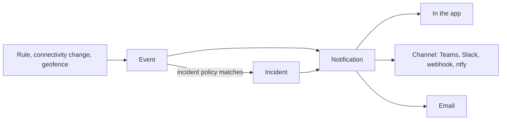

When something goes wrong in your installation, IoT Breeze does three separate things: it records what happened, decides whether a person has to deal with it, and tells people. Keeping these apart is what stops twenty identical alarms from becoming twenty phone calls.

## The parts

| Part | What it is | How many |
| --- | --- | --- |
| **Event** | A record that something happened: a rule matched, a thing went offline, a thing left a geofence. A fact with a time, a thing and a severity. | Many. Most need nobody. |
| **Incident** | A problem that needs a person. It collects the events that belong together and moves from **Open** to **Closed**. | Few. One per problem. |
| **Incident policy** | The rule that decides which events open an incident, and how events are grouped into one. | A handful per tenant. |
| **Notification** | A message about an event or an incident, in the app, in a channel or by email. | As many as you route. |

## How they work together

An event is always recorded. You see it under **Monitoring › Events** and on the thing's **Events** tab.

If an incident policy matches the event, the event either opens a new incident or joins the open one it belongs to. Someone acknowledges the incident, works on it and resolves it; the incident keeps the history.

Notifications come from both. A notification channel with **Automatic routing** receives every event and incident notification that meets its filters. An event type can also post to a named channel, or send an email, as an action. An incident policy can post once when an incident opens or escalates.

## Choosing between them

| You want… | Use |
| --- | --- |
| A record of what happened | Nothing to set up. Rules, connectivity and geofences create events. |
| Someone to own a problem until it is fixed | An [incident policy](./incident-policy.mdx). |
| Messages in your team's chat | A [notification channel](./alert-channels.mdx) with automatic routing. |
| An email to a particular person or list | An Email action on the event type or the rule. |

## Limits

- Email is not a channel. Email goes out through an Email action.
- Events that end a state, such as a thing coming back online, are not routed to channels.

## Related

- [Work an incident](./work-an-incident.mdx)
- [Event types](./event-types.mdx)
- [Channel types](./channel-types.mdx)
