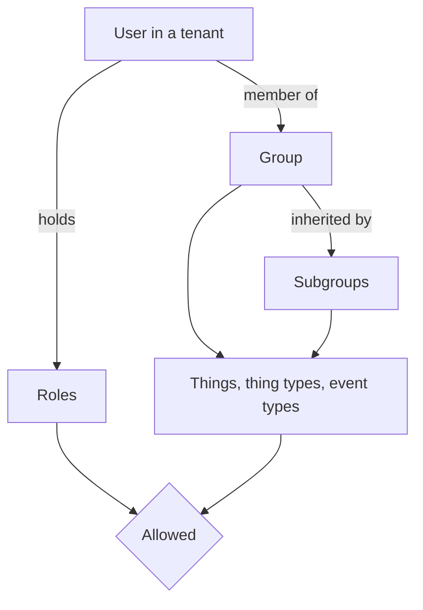

Two things decide what a person can do in IoT Breeze: their **roles** and their **groups**. Roles say what kinds of action they may take, such as editing things or creating dashboards. Groups say which things those actions apply to. A person needs both: a role without a group reaches nothing, and a group without a role gives no rights to act.

## The parts

| Part | What it is | Decides |
| --- | --- | --- |
| **User** | A person who signed in to your tenant. | Nothing alone. Carries roles and group memberships. |
| **Role** | A named set of permissions, such as "may update things". Four system roles exist; you can add custom ones. | What kind of action: create, read, update, delete, execute, per resource type. |
| **Group** | A container for users and for the things, thing types and event types they work with. Groups form a tree. | Which things, thing types and event types a person reaches. |
| **Group membership** | A user in a group, with **Read**, **Update** and **Execute** switches. | What the person may do with that group's content: see it, change it, run actions on it. |
| **Organization** | A group of type **Organization**. A thing records one organization. | Nothing by itself. See [Organizations](#organizations). |

## How they work together

**Roles are added together.** A user with several roles holds the union of their permissions. Roles apply per tenant: the same person can be an **Admin** in one tenant and a **Viewer** in another.

**Groups scope the things.** A user sees a thing when one of these is true:

- The thing is in a group, or in a subgroup of a group, where the user has **Read**.
- The thing's thing type is in such a group. The user then sees every thing of that type.
- The user was given access to that single thing.
- The user created the thing.

**Subgroups inherit.** A membership in a group applies to every group below it. A user in `Customer A` also reaches `Customer A / Berlin` and everything below it. A user in `Berlin` does not reach `Customer A`. If a user is a member at several levels of the same branch, the flags add up: **Update** on the parent and **Read** on a subgroup gives both on the subgroup. The group's **Users** tab marks such members **Inherited**.

**Both checks must pass.** To change a thing, the user needs a role that allows updating things and **Update** on a group that contains it. To run a command on it, the role and the group both need to allow **Execute**.

## Organizations

An organization is an ordinary group with the type **Organization**. It marks the top of a customer, company or site in your group tree, and it is what you pick in the **Organization** field of a thing.

Choosing an organization on a thing records which customer or site it belongs to. It does not give anyone access. Access still comes from the groups the thing is in. Put the thing in the organization's group as well when the people in that group should see it.

{/* TODO(product): The Organization permission exists in the role matrix. What does it control: creating and editing organization-type groups, or something else? */}

## Choosing between them

| You want… | Use |
| --- | --- |
| Someone to see only one customer's things | A group per customer. Put the person and the things in it. |
| One person to see all customers | Add them to the parent group, or to each customer group. |
| Someone to watch but never change | The **Viewer** role. See [Roles and permissions](./roles.mdx). |
| Someone to run actions on things but not edit them | A role that allows **Execute**, and **Execute** without **Update** in the group. |
| One person to see a single thing | Give them that thing when you [invite them](./invite.mdx), or add the thing to a group they are in. |
| A rights set none of the four system roles gives | A custom role. System roles cannot be changed. |

## Limits

- The tenant owner cannot be removed. The last user with the **Admin** role cannot be removed or lose that role.
- You can only grant a role, or a permission in a custom role, that you hold yourself.
- Removing a user from a group, or deleting a group, removes the access it gave. The things themselves stay.
- The tenant chooser at sign-in says "organization" where it means tenant. A group of type **Organization** is something else.

## Related

- [Roles and permissions](./roles.mdx)
- [Invite a colleague](./invite.mdx)
- [Give a team access to its things](./team-access.mdx)
