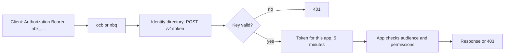

An API key is a secret that lets a script, an integration or an AI assistant call IoT Breeze without a person signing in. It acts as one member of your organization, can do only what its scopes allow, and expires.

A key looks like `nbk_<key id>_<secret><checksum>`. The key id is the public handle you see in lists and logs. IoT Breeze stores only a hash of the secret, so the full key is shown once, when you create it.

## The parts

### Kinds of machine credential

| Kind | Acts as | Notes |
| --- | --- | --- |
| Personal key | You | Never has more rights than you hold. Always expires within a year. Stops working when you are no longer a usable member. Tenant policy can switch personal keys off. |
| Service account key | A service account | The account is a member that never signs in and holds the roles you give it. Its keys survive staff changes. Can be allowed scopes marked **Sensitive** and, if the policy sets no maximum, no expiry. |
| Gateway credential | A gateway | Not an `nbk_` key. A box such as Periscope redeems a one-time onboarding code, then signs its requests with its own key pair. Managed on the gateways page, see [Connect devices through a gateway](../connect/gateways.mdx). |

Two things look similar and are different. **Connected apps** on the API keys page are AI assistants that you allowed to act as you through a consent screen. Device credentials (basic and JWT) belong to one thing and only send data; see [Authentication](./authentication.mdx#device-and-tenant-credentials-tsflux).

### Scopes

A scope is a named permission set that belongs to one app. You tick scopes when you create a key. Examples from the catalogue:

| Scope | App | Label |
| --- | --- | --- |
| `ocb:read` | OCB | Read the platform |
| `things:write`, `rules:manage`, `dashboards:manage`, `reports:run`, `files:manage`, `events:write` | OCB | Manage or write the named area |
| `users:manage` | OCB | Sync members. Sensitive. |
| `telemetry:read` | nbq | Read time series |
| `events:read` | nbq | Read events |

The create dialog lists the scopes available to you. It also offers presets: **Read only**, **AI assistant** and **ERP or MES integration**.

### Key policy

Admins set four rules for the organization under **Edit policy**: whether members may create personal keys, the maximum lifetime, how long an unused key may sit idle before it stops, and whether service accounts may hold sensitive scopes. Without a saved policy the defaults are: a year at most, personal keys allowed, no sensitive scopes, no idle limit. The policy applies at every request, not only at creation.

## How they work together

A key is not sent to the APIs as a long-lived token. When a request arrives with `Authorization: Bearer nbk_...`, ocb or nbq asks the identity directory to exchange the key for an access token that is valid for five minutes and then checks that token like a person's.

The directory refuses the key with one answer, `401`, if it is malformed, unknown, revoked, expired, idle past the policy limit, used from an address outside its **Allowed addresses**, or if its principal is no longer a usable member. Otherwise the token carries the owner's permissions narrowed to the key's scopes, and an audience naming one app. The app rejects a token meant for another app.

Because a token is for one app, a key that holds scopes for several apps gets one token per app. ocb and nbq do this for you when you send the key as the bearer. The exchange itself is documented in [Authentication](./authentication.mdx#api-key-exchange).

OCB routes that declare permissions are decided by those permissions. Routes that are meant for a signed-in person answer `403` with `API_KEY_NOT_ALLOWED`. Only `GET /users/me` is open to keys among them.

## Choosing between keys

| You want to | Use |
| --- | --- |
| Run a script as yourself for a while | A personal key with the **Read only** preset or the scopes you need. |
| Run an integration that must outlive staff changes | A service account key. |
| Connect a Periscope box on a plant network | A gateway credential. |
| Send device data | The thing's device credentials, not a key. |
| Work in IoT Breeze yourself | Sign in. No key needed. |

## Lifetime and rotation

- **Expiry.** Choose 30, 90 or 365 days. **Never** is offered only for service account keys when the policy sets no maximum. No access token outlives its key.
- **Roll key** creates a new key with the same scopes. You choose when the old one stops: now, after 1 hour, after 1 day or after 7 days. Give your clients the new key before then.
- **Revoke** ends a key for good. Clients that use it stop working within five minutes, the life of a token already issued.
- A key that is unused for longer than the policy's idle limit stops working.
- **History** keeps changes and refused uses for a year, and daily use for 90 days.

## Keep keys safe

- Store keys in a secret manager. The `nbk_` prefix and checksum let secret scanners recognize a leaked key.
- Create one key per integration so you can revoke one without breaking others.
- Pick the smallest scope set. Prefer **Read only** and add scopes as you need them.
- Set **Allowed addresses** to the networks the integration runs from.
- Use short expiry and roll before it ends.
- Call the APIs from a server. The key exchange sends no CORS headers, so a browser page cannot use a key.

## Limits

- A key works with OCB, nbq and the AI endpoints. It does not work for sending data to tsflux or MQTT.
- The exchange is rate limited. See [Errors and limits](./errors-and-limits.mdx#limits).
- API keys must be enabled for your deployment. When they are off, the exchange answers `404`.

## Related

- [Create an API key](../administer/api-key.mdx) · [Authentication](./authentication.mdx) · [Errors and limits](./errors-and-limits.mdx)
