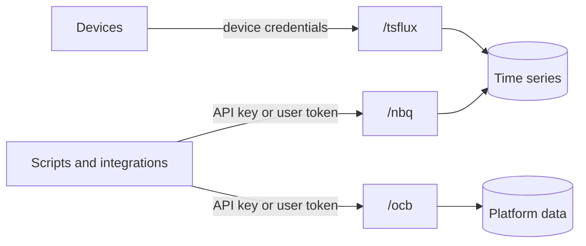

IoT Breeze has three HTTP APIs: one takes device data in, one reads time series and events out, and one manages the platform itself.

## Which API for what

| API | Path prefix | Use it to | Accepts |
| --- | --- | --- | --- |
| Ingest API (tsflux) | `/tsflux` | Send device messages as JSON, InfluxDB line protocol or InfluxDB-compatible writes. | Device or tenant credentials (basic, JWT). Not API keys. |
| Query API (nbq) | `/nbq` | Read time series, snapshots, positions, events and metrics. | API keys, user access tokens. |
| Platform API (OCB) | `/ocb` | Manage things, thing types, rules, dashboards, users and the rest of the tenant. | API keys, user access tokens. |

The OCB REST API lives under `/ocb/rest/v2`. The tsflux and nbq APIs live under `/api/v1` after the prefix, for example `/tsflux/api/v1/message/structured`.

{/* TODO(product): The repository's legacy compose stack still routes `/dip` to the older GoDIP service. Is `/dip` served in production, and should it be documented? */}

## Understand

- [API keys](./api-keys.mdx): what a key is, which kinds exist, and how a request with a key is checked.

## Do

- [Create an API key](../administer/api-key.mdx): the click path in IoT Breeze, and a first call to test it.
- [Send alerts to Teams, Slack or a webhook](../watch/alert-channels.mdx): receive IoT Breeze notifications in your own system.

## Look up

- [Authentication](./authentication.mdx): base URL, every credential each API accepts, with exact headers.
- [Webhook payloads](./webhooks.mdx): what IoT Breeze sends and how to verify the signature.
- [Errors and limits](./errors-and-limits.mdx): error formats, status codes, rate and size limits.
- [Ingest API reference](./reference/tsflux.mdx), [Query API reference](./reference/nbq.mdx), [Platform API reference](./reference/ocb.mdx): every endpoint, generated from the OpenAPI specs.
