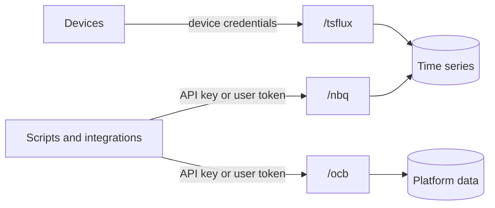

IoT Breeze has three HTTP APIs: one takes device data in, one reads time series and events out, and one manages the platform itself. This section tells you which to call, how to sign in to each, and what comes back when something goes wrong.



## Which API for what

| API | Path prefix | Use it to | Accepts |
| --- | --- | --- | --- |
| Ingest API (tsflux) | `/tsflux` | Send device messages as JSON, InfluxDB line protocol or InfluxDB-compatible writes. | Device or tenant credentials (basic, JWT). Not API keys. |
| Query API (nbq) | `/nbq` | Read time series, snapshots, positions, events and metrics. | API keys, user access tokens. |
| Platform API (OCB) | `/ocb` | Manage things, thing types, rules, dashboards, users and the rest of the tenant. | API keys, user access tokens. |

The OCB REST API lives under `/ocb/rest/v2`. The tsflux and nbq APIs live under `/api/v1` after the prefix, for example `/tsflux/api/v1/message/structured`.

{/* TODO(product): The repository's legacy compose stack still routes `/dip` to the older GoDIP service. Is `/dip` served in production, and should it be documented? */}

## Base URL

Use the host you open IoT Breeze on, with the path prefix of the API: `https://<host>/nbq/api/v1/...`. All three APIs share the host. The tenant is not part of the URL: it comes from the credential. The one exception is the device telemetry route of tsflux, which also carries the tenant in its path.

{/* TODO(product): Does every tenant get its own host (primary and additional domains are registered per tenant), or do tenants of a shared cell share one host? Say which hostname an integrator should use. */}

## Your first authenticated request

Create an API key first (see [Create an API key](../administer/api-key.mdx)) with the scope **Read the platform** (`ocb:read`). Then read the identity the key acts as:

```bash
curl "https://<host>/ocb/rest/v2/users/me" \
  -H "Authorization: Bearer <api-key>"
```

A `200` answer with a user object means the key is valid and reaches OCB. A `401` means the key is malformed, expired, revoked or has no scope for OCB. See [Errors and limits](./errors-and-limits.mdx).

To read data, give the key the scope `telemetry:read` and call nbq with the same header:

```bash
curl "https://<host>/nbq/api/v1/datasources" \
  -H "Authorization: Bearer <api-key>"
```

Sending data is different: devices sign in with their own credentials, not with an API key. See [Authentication](./authentication.mdx#device-and-tenant-credentials-tsflux).

## Understand

- [API keys](./api-keys.mdx): what a key is, which kinds exist, and how a request with a key is checked.

## Do

- [Create an API key](../administer/api-key.mdx): the click path in IoT Breeze.
- [Send alerts to Teams, Slack or a webhook](../watch/alert-channels.mdx): receive IoT Breeze notifications in your own system.

## Look up

- [Authentication](./authentication.mdx): every credential each API accepts, with exact headers.
- [Webhook payloads](./webhooks.mdx): what IoT Breeze sends and how to verify the signature.
- [Errors and limits](./errors-and-limits.mdx): error formats, status codes, rate and size limits.
- [Ingest API reference](./reference/tsflux.mdx), [Query API reference](./reference/nbq.mdx), [Platform API reference](./reference/ocb.mdx): every endpoint, generated from the OpenAPI specs.
