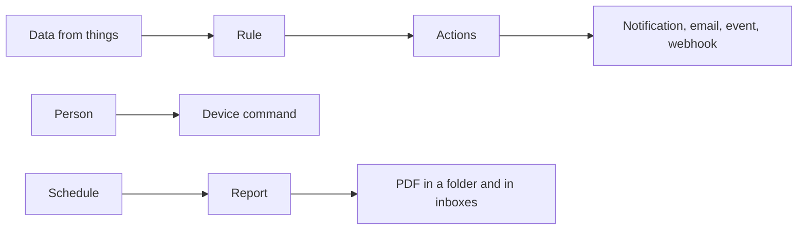

This section answers one question: how do I make the platform act without someone watching a dashboard? A rule reacts to incoming data, a device command reacts to a person, and a report runs on a clock.

## Understand
- [Rules, actions and reports](./rules-actions-reports.mdx): what each automation does, and the three different lists of "actions".

## Do
- [Alert when a value crosses a limit](./threshold-alert.mdx): notify yourself when a temperature goes above 25 °C.
- [Send a command to a device](./device-command.mdx): define an MQTT command and fire it from a thing page or a dashboard.
- [Call another system from a rule](./webhook-from-rule.mdx): add a webhook action to a rule.
- [Email a weekly PDF report](./weekly-report.mdx): build a report, schedule it and add subscribers.

## Look up
- [Rule conditions and functions](./conditions.mdx): Simple and Advanced conditions, operators, window functions.
- [Action types](./action-types.mdx): every action you can add, by where you add it.
- [Report settings](./report-settings.mdx): every field of a report and its schedule.
- [Node-RED](./node-red.mdx): the external flow editor.
