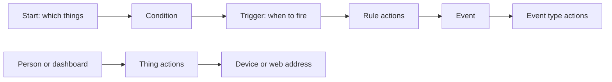

IoT Breeze automates in three ways. A rule watches incoming data and runs actions when a condition holds. A device command is an action a person fires on purpose. A report builds a PDF on a schedule. The word "action" appears in all three places, and the lists of action types are different in each.

## The parts

| Part | What it is | Where you build it |
| --- | --- | --- |
| **Rule** | A chain of four nodes: **Start**, **Condition**, **Trigger**, **Actions**. It is evaluated each time a thing in scope sends data. | **Automation › Rule Designer** |
| **Rule action** | A step a rule runs when its trigger fires. | The **Actions** node of a rule |
| **Event type action** | A step that runs whenever an event of that type is created, whatever created it. | **Actions** tab of an event type under **Configuration › Event Types** |
| **Thing action** | A command defined once on a thing type or a thing and fired by a person or a dashboard. | **Actions** tab of a thing type or thing |
| **Report** | A document of widgets that IoT Breeze renders to PDF, stores in a folder and sends to subscribers. | **Automation › Reports** |

## Three lists of actions

Each place offers a different set. [Action types](./action-types.mdx) has the fields of each.

| Where | Action types |
| --- | --- |
| Rule | **Notification**, **Notification channel**, **Email**, **Webhook**, **Event**, **Update Measures** |
| Event type | **Notification**, **Notification channel**, **Email**, **Webhook** |
| Thing type or thing | **Webhook**, **Azure C2D**, **MQTT** |

A rule cannot fire a thing action such as an MQTT command. A rule can create an event with its **Event** action, and the event then runs the actions of its event type. That is the way from a rule to everything an event type does, including incidents and channel routing.

## How they work together

A rule evaluates a condition on every message from the things in its **Start** node. The **Trigger** decides how the result becomes firing: every match, only after the condition held for a while, once per period, or only when the state changes. Only then do the actions run.

Most alerting setups use a rule with an **Event** action. The event is recorded, an [incident policy](../watch/incident-policy.mdx) can group it into an incident, and notification channels with automatic routing pick it up. See [Events, incidents and notifications](../watch/events-incidents-notifications.mdx).

A report is independent of rules. It reads data like a dashboard, over a window you set, on its own schedule.

## Choosing between them

| You want… | Use |
| --- | --- |
| A message to yourself or a group when a value crosses a limit | A rule with a **Notification** action: [Alert when a value crosses a limit](./threshold-alert.mdx) |
| Another system called when a condition holds | A rule with a **Webhook** action: [Call another system from a rule](./webhook-from-rule.mdx) |
| A record and incident handling, more than a message | A rule with an **Event** action, then an incident policy |
| A device to do something when a person decides | A thing action: [Send a command to a device](./device-command.mdx) |
| The same summary at the same time every week | A report: [Email a weekly PDF report](./weekly-report.mdx) |
| Logic that conditions and triggers cannot express | [Node-RED](./node-red.mdx), if your administrator enabled it |

## Limits

- The rule canvas and the report editor need a desktop browser.
- One version of a rule is active at a time.
- **Update Measures** works only when the rule's **Start** node uses a thing type, not tags.
- Email is sent through the **Email** action. A notification channel cannot be an email address.

## Related

- [Rule conditions and functions](./conditions.mdx)
- [Action types](./action-types.mdx)
- [Report settings](./report-settings.mdx)
