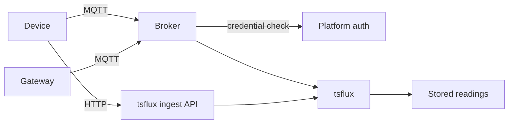

Data comes into IoT Breeze mainly over MQTT. Whoever connects proves who they are with a credential, and the credential decides which things they may send for: a device's credential covers its own thing, a gateway's credential covers the things assigned to the gateway. Every message is checked against the thing's thing type before it is stored.

## The parts

| Part | What it does |
| --- | --- |
| Thing | One device or asset, with an ID, a thing type and credentials. |
| Thing type | Decides which measures are accepted. A message names it in `thingType`. |
| Credential | Proves who connects: a basic username and password, or a JWT token. A device credential is signed by the thing's **Device key** and covers that thing. A gateway credential covers the things assigned to the gateway. |
| Gateway | One box that sends for many things, such as an eWON Flexy or a Periscope agent. See [How gateways work](../gateways/how-gateways-work.mdx). |
| Broker | The MQTT endpoint. It asks the platform to check the credential and then limits the device to its own topics. |
| tsflux | The ingestion service. It reads MQTT messages and serves the HTTP endpoints. It checks, resolves and stores each message. |

## How they work together

The same credential works on both protocols. Over MQTT it is checked once, when the client connects, and the broker then confines the device to its own topics. Over HTTP it is checked on every request.

tsflux then looks up the thing and its thing type. A message is stored when the thing exists, the thing type matches, and at least one value or a location is left after the checks. A measure that is not in the published thing type is dropped, unless the thing type has **Auto Schema Evolution** on. In that case the measure is added to the thing type and a new version is published at once. See [Drafts, publishing and versions](../model/drafts-and-versions.mdx).

## Three ways onto the broker

| Who connects | Credential | Publishes on | Sends for |
| --- | --- | --- | --- |
| A device | Its own device credential | `tenant/<tenantId>/device/<deviceId>/telemetry` | Its own thing. |
| An MQTT gateway | The gateway's credential, issued when you add the gateway | `tenant/<tenantId>/gateway/<gatewayId>/device/<thing>/telemetry`, or one JSON array for several things on `tenant/<tenantId>/gateway/<gatewayId>/telemetry` | Things assigned to the gateway. |
| Periscope | A gateway credential it requests itself after you onboard it with a code | The same gateway topics, or HTTP and stream ingest | Things assigned to the gateway, which it can also create. |

A gateway's message for a thing that is not assigned to it is discarded and counted on the gateway. The exact topics and client IDs are in [MQTT topics and client ID](./mqtt-topics.mdx).

## Choosing between protocols

| You want | Use |
| --- | --- |
| A permanent connection, low overhead, commands sent back to the device | [MQTT](./mqtt.mdx) |
| To send from a script, a server or a device that only speaks HTTP, with an answer for each request | [HTTP](./http.mdx) |
| To keep an InfluxDB client, Telegraf or an existing line protocol writer | [Line protocol](./line-protocol.mdx) |
| To test without hardware | [Simulate a device](./simulate.mdx) |
| Many devices behind one box that speaks MQTT | [An MQTT gateway](../gateways/mqtt-gateway.mdx) |
| PLCs, OPC UA servers or Modbus devices on site | [Periscope](../gateways/periscope/index.mdx) as a gateway |

Commands travel only over MQTT, and only to a device that is connected at that moment.

## Limits

| Limit | Value |
| --- | --- |
| MQTT versions and QoS | 3.1.1, QoS 0 and 1. |
| HTTP body | 10 MiB. |
| Where the port and TLS setting come from | Your deployment. **Gateway url** in **Connection info** shows them. |

## Related

- [MQTT topics and client ID](./mqtt-topics.mdx) · [Ingest endpoints and status codes](./ingest-endpoints.mdx)
- [Thing types, things and interfaces](../model/things-and-types.mdx)
