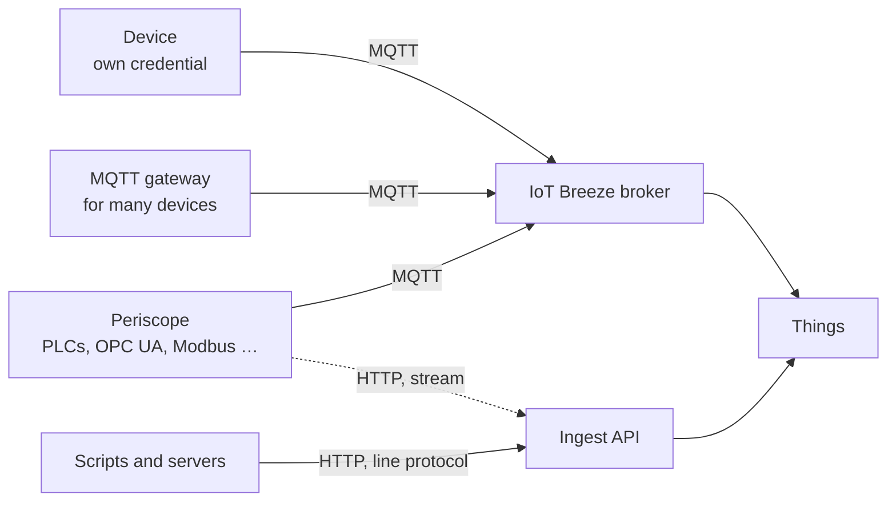

This section answers one question: how do I get data in? MQTT is the main way. A single device connects to the IoT Breeze broker with its own credential. A gateway connects with one credential and sends for all the devices behind it. Periscope, the edge agent, is such a gateway. HTTP and InfluxDB line protocol are there for scripts and for writers you already have.

## Pick your path

| You have | Start here |
| --- | --- |
| One device that sends its own data | [Send data over MQTT](./mqtt.mdx) |
| A box that sends for many devices and speaks MQTT, such as an eWON Flexy | [Send data for many devices through one MQTT gateway](../gateways/mqtt-gateway.mdx) |
| Machines and field networks: PLCs, OPC UA servers, Modbus devices | [Periscope](../gateways/periscope/index.mdx), deployed as a [gateway](../gateways/add-a-gateway.mdx) |
| A script, a server or a device that speaks only HTTP | [Send data over HTTP](./http.mdx) |
| An InfluxDB client or Telegraf | [Write InfluxDB line protocol](./line-protocol.mdx) |
| No hardware yet | [Simulate a device](./simulate.mdx) |

## Understand
- [How devices connect](./how-devices-connect.mdx): credentials, the ways onto the broker, and what happens to a message.
- [How gateways work](../gateways/how-gateways-work.mdx): one credential for a box that speaks for many devices.

## Do
- [Send data over MQTT](./mqtt.mdx): publish telemetry with mosquitto_pub, Python or Node.js.
- [Create and rotate device credentials](./credentials.mdx): basic credentials, tokens and the device key.
- [Simulate a device](./simulate.mdx): test dashboards and rules without hardware.
- [Send data over HTTP](./http.mdx): post JSON with curl, Python or Node.js.
- [Write InfluxDB line protocol](./line-protocol.mdx): write lines, or point an InfluxDB client at tsflux.

## Look up
- [MQTT topics and client ID](./mqtt-topics.mdx): broker, client IDs, topics and QoS, for devices and gateways.
- [Message format](./message-format.mdx): every field of a message.
- [Ingest endpoints and status codes](./ingest-endpoints.mdx): URLs, authentication and answers.
