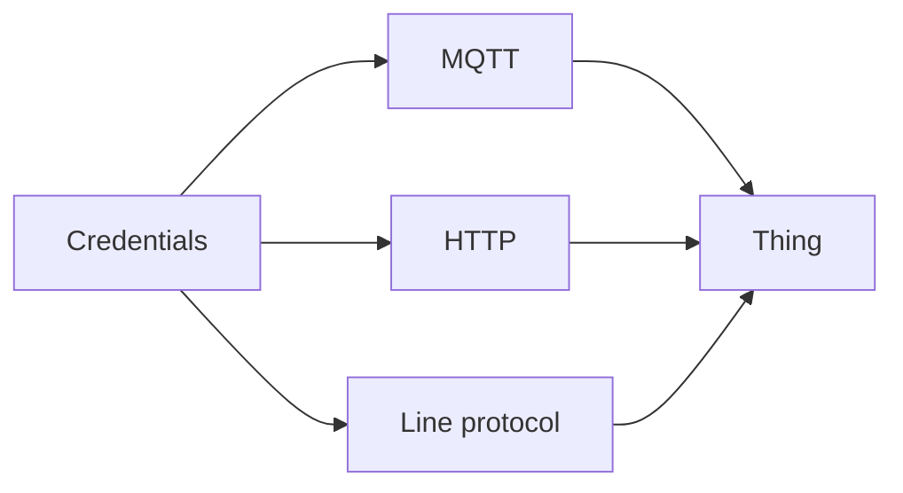

This section answers one question: how do I get data in? It covers credentials, the three ways a device sends data, testing without hardware, and the exact topics, endpoints and fields.

## Understand
- [How devices connect](./how-devices-connect.mdx): credentials, protocols and what happens to a message.

## Do
- [Send data over MQTT](./mqtt.mdx): publish telemetry with mosquitto_pub, Python or Node.js.
- [Send data over HTTP](./http.mdx): post JSON with curl, Python or Node.js.
- [Write InfluxDB line protocol](./line-protocol.mdx): write lines, or point an InfluxDB client at tsflux.
- [Simulate a device](./simulate.mdx): test dashboards and rules without hardware.
- [Create and rotate device credentials](./credentials.mdx): basic credentials, tokens and the device key.
- Connect through a box on site: [Gateways](../gateways/index.mdx).

## Look up
- [Message format](./message-format.mdx): every field of a message.
- [MQTT topics and client ID](./mqtt-topics.mdx): broker, client ID, topics and QoS.
- [Ingest endpoints and status codes](./ingest-endpoints.mdx): URLs, authentication and answers.
