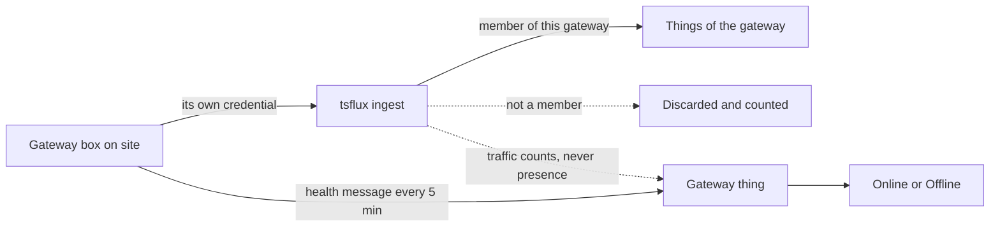

{/* TODO(product): confirm after PRs #1613–#1623 merge */}

A gateway is one box on site that speaks for many devices. Instead of giving every device its own credential, you give the box one credential. The platform lets that credential send data only for the things assigned to the gateway, and watches the box's own heartbeat to tell you whether it is alive.

## The parts

| Part | What it is |
| --- | --- |
| **Gateway** | A record in your organization with a name, a type, a namespace and a scope. You manage it under **Settings › Onboarding › Gateways**. |
| **Type** | **Periscope**: a [Periscope](./periscope/index.mdx) agent that signs in with its own key. **MQTT device**: a device that connects over MQTT with a username and password, for example an eWON Flexy. |
| **Gateway thing** | One thing that IoT Breeze creates with the gateway, with the alternate ID `gateway-<gateway id>`. Its connection status is the gateway's status. It is removed with the gateway, and you can't delete it on its own. |
| **Namespace** | The prefix of the alternate IDs of the gateway's things: they equal the namespace or start with `<namespace>-`. IoT Breeze derives it from the name unless you type one. |
| **Scope** | What the gateway may create: things inside its namespace, of the allowed thing types, up to a thing limit. The **Creation policy** is **Open** or **Locked**. |
| **Membership** | A thing belongs to at most one gateway. The record decides, not where the data arrived. |

## How they work together

**Signing in.** For a Periscope gateway you get a one-time onboarding code. The box redeems it once, creates its own key pair, and from then on signs in with that key. For an MQTT device you get a broker username and password, shown once, and a config file that holds them.

**Sending data.** Over MQTT, a gateway's credential can publish only on topics that contain its own gateway ID. Over HTTP and stream ingest, a Periscope gateway's token names the gateway. For each message, the platform then checks that the thing belongs to the gateway. A message for a thing of another gateway, for a thing that doesn't exist, or one that is malformed is discarded and counted by reason. See [Check gateway health and traffic](./fleet-health.mdx).

**Creating things.** A Periscope box creates its own thing types and things, and every thing it creates is stamped with the gateway. An MQTT device has no API access, so you create its things in IoT Breeze and assign them to the gateway. A **Locked** gateway creates no new things by any path. Things it already has keep working.

**Being alive.** The gateway thing goes **Online** when the box's own health message arrives, which is every 5 minutes, and **Offline** after 15 minutes without one. The platform's traffic counts are written to the same thing but never make it online, so a dead box can't look alive. Each thing behind a gateway has its own timeout, so a gateway can be online while one device behind it is offline.

**Cutting a gateway off.** Revoke a key, issue a new onboarding code or credential, or delete the gateway. An already connected MQTT session ends within ten minutes. A Periscope box's HTTP and stream tokens last at most ten minutes.

## Is a Periscope instance a gateway?

Only if you onboard it with an onboarding code. Then it is a gateway of type **Periscope**: it has a record, a gateway thing, a namespace and a scope, and it can send only for its own things.

A Periscope agent can also run as a service account (an email and password enrolled once). That agent is not a gateway. It has no record, no namespace and no health thing, and it sends with a tenant-wide credential. Use the onboarding code for new installations.

## Choosing between

| You have | Use |
| --- | --- |
| A machine next to the equipment that can run Periscope | A **Periscope** gateway. It discovers sources and creates things. |
| A device that speaks MQTT and can't run software of ours | An **MQTT device** gateway. You model the things in IoT Breeze. |
| One device that sends only its own data | No gateway. [Send data over MQTT](../connect/mqtt.mdx) with a device credential. |

## Limits

- At most 1000 Periscope gateways per organization.
- A thing belongs to at most one gateway.
- An MQTT device can send for a thing only after the thing exists and is assigned to the gateway. Unknown things are not created from its messages.
- Gateways need API keys. If your operator has turned them off, the page says **Gateways are not enabled**.

## Related

- [Add a gateway](./add-a-gateway.mdx)
- [Send data for many devices through one MQTT gateway](./mqtt-gateway.mdx)
- [Gateway reference](./gateway-reference.mdx)
- [Thing types, things and interfaces](../model/things-and-types.mdx)
