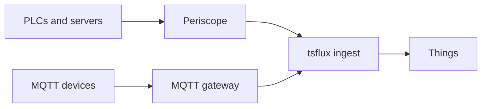

This section answers one question: how do I bring in machines and field networks? A gateway is one thing that speaks for many devices. Periscope is the edge agent that runs next to your equipment, discovers its sources and streams their values to IoT Breeze.

## Understand
- [How gateways work](./how-gateways-work.mdx): what a gateway may send for, and how IoT Breeze knows it is alive.
- [How Periscope works](./periscope/how-periscope-works.mdx): discovery, mapping and streaming on the edge box.

## Do
- [Add a gateway](./add-a-gateway.mdx): create a Periscope gateway and enroll the box with a code.
- [Send data for many devices through one MQTT gateway](./mqtt-gateway.mdx): one credential for a device such as an eWON Flexy.
- [Check gateway health and traffic](./fleet-health.mdx): find offline gateways and discarded messages.
- [Install Periscope and stream your first source](./periscope/install.mdx): from download to values in IoT Breeze.

## Look up
- [Gateway reference](./gateway-reference.mdx): fields, statuses, limits, measures and discard reasons.
- [Periscope](./periscope/index.mdx): inputs, outputs, configuration and commands for the edge agent.
