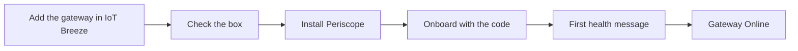

Use this section to run Periscope on a box in production and keep it healthy. It starts where the [first-steps tutorial](../install.mdx) ends: you have seen it work once, and now you install it on every site. A box is ready when its gateway shows **Online** in IoT Breeze.

The path takes five steps:

1. In IoT Breeze, [add a gateway](../../add-a-gateway.mdx) and copy its onboarding code.
2. Check the box against the [requirements](./requirements.mdx).
3. Install Periscope [in a container](./run-in-a-container.mdx) or [as a service](./run-as-a-service.mdx).
4. [Onboard the box](./onboard.mdx) with the code.
5. Wait for the first health message. It is sent about 15 seconds after the agent has learned its gateway's namespace, and the gateway is **Online** when it arrives.

## Understand
- [What Periscope keeps on the box](./state-and-backup.mdx): the files that make a box a gateway, and what to back up.
- [How gateways work](../../how-gateways-work.mdx): namespace, scope and health, from the platform side.

## Do
- [Run Periscope in a container](./run-in-a-container.mdx)
- [Run Periscope as a service](./run-as-a-service.mdx)
- [Onboard a box with an onboarding code](./onboard.mdx)
- [Upgrade a box](./upgrade.mdx): what changes, and in which order.
- [Move a box from a service account to a gateway](./move-to-a-gateway.mdx)
- [Replace a box](./replace-a-box.mdx)

## Look up
- [Requirements for an edge box](./requirements.mdx): systems, disk, network and clock.
- [Configuration reference](../configuration.mdx) · [Command-line reference](../commands.mdx)
