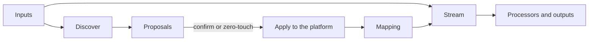

Periscope is a single Go binary configured with one TOML file. It does two jobs over one connection to your plant: discovery, which creates the model, and streaming, which sends the values. It needs no change in other services, and nothing has to reach it except the people who open its web UI.

## The parts

| Part | What it does |
| --- | --- |
| **Input** | Reads one source: OPC UA, Sparkplug B, MQTT or UNS, Siemens S7, Modbus or an HTTP API. Each input has an `alias`, and its address space is read-only. |
| **Snapshot** | The last discovery of an input: folders, objects and variables with units, ranges and names where the source has them. |
| **Proposals** | Thing types, things and measures derived from the snapshot, each with a status. The same plant always produces the same proposals with the same IDs. |
| **Mapping** | Which source address feeds which thing and measure. Apply writes it. |
| **Processor** | Changes values on the way: rename, scale, thin out, tag, convert. |
| **Output** | Sends values to the platform: `tsflux_stream`, `tsflux`, `nimbit_mqtt`, and `file` or `stdout` for tests. |
| **State directory** | Everything the agent keeps: snapshots, proposals, edits, mapping, keys, queues. |

## How they work together

1. **Discover.** Each input reads its source and writes a snapshot. Periscope derives proposals: one thing type per kind of machine, one thing per machine, one measure per variable, placed under your `mount` path. It repeats every hour by default.
2. **Confirm.** In `confirm` mode, a person reviews proposals in the web UI, renames and merges them, and confirms the rest. In `zero-touch` mode everything proposed is applied at once. A rediscovery sends a changed item back to `proposed`. Nothing is renamed or deleted silently.
3. **Apply.** Periscope creates the confirmed thing types and then their things in IoT Breeze, and writes the mapping. Applying again creates nothing twice.
4. **Stream.** Inputs deliver values, the mapping assigns each to a thing and measure, processors change them, and outputs send them.
5. **Verify.** You check that every applied thing received values. See [Verify that data arrived](./verify.mdx).

`periscope serve` runs all of this continuously and serves the web UI and the HTTP API on one port.

## Is a Periscope instance a gateway?

Only when you onboard it with an onboarding code from **Devices › Gateways**. Set `[ocb] gateway = true` and the agent signs in with its own key, sends with a credential that names the gateway, and may create and update only its own things. IoT Breeze shows it as a gateway with a status, a namespace and a scope. See [How gateways work](../how-gateways-work.mdx).

On a gateway, the agent also does three things that the other mode doesn't. It asks the platform for its gateway's record (`gateways.me`) and uses the namespace from it as the prefix of every alternate ID. Until the platform answers, it discovers and applies nothing. It requests the gateway's own data credential for its outputs, and renews the short-lived tokens that ingest needs. And it sends a health message every `agent.health_interval`, which turns the gateway **Online**. [Onboard a box](./deploy/onboard.mdx) shows the steps.

Without that, the agent runs in service-account mode: it signs in as a user of your organization with the `modeler` role, is not a gateway, and has no gateway thing, namespace or scope. New installations should use a gateway.

| | Gateway mode | Service-account mode |
| --- | --- | --- |
| Sign-in | Key pair, onboarding code | Email and password, enrolled once |
| Thing alternate IDs start with | The gateway's namespace | `agent.name` |
| Data credential | The gateway's own, valid only for its things | The tenant's, valid for every thing |
| Appears in **Gateways** | Yes | No |
| Health shown in IoT Breeze | Yes, on the gateway thing | No |
| Placement posted to Contexus | No, the gateway's token is for the platform backend only | Yes, when the organization has Contexus on |

## Limits

- The agent reads sources and never writes to them.
- A thing's identity, its alternate ID, starts with `agent.name`, or with the gateway's namespace on a gateway, and may include an input's own `mount`. Changing any of them later creates new things. The `mount` under `[ocb]` sets where things sit, and is not part of the alternate ID.
- In gateway mode the agent sends health live, never from a queue, so a replayed backlog can't keep a dead agent online.

## Related

- [Install Periscope and stream your first source](./install.mdx)
- [Deploy Periscope](./deploy/index.mdx)
- [Configuration reference](./configuration.mdx)
- [Add a gateway](../add-a-gateway.mdx)
