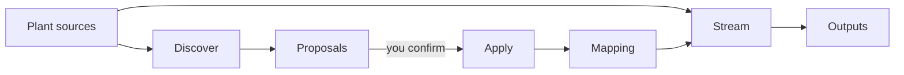

Periscope is one program that runs on a machine next to your equipment. It reads your plant without writing to it, proposes the thing types and things that describe it, creates them in IoT Breeze once you confirm them, and then streams their values. Use this section to install it, connect each kind of source and look up its settings.

The agent serves its full documentation at `http://<listen>/ui/docs`, so an engineer at the box can read it without internet access. This section covers the same ground from the platform side.

## Understand
- [How Periscope works](./how-periscope-works.mdx): the stages, and whether an instance is a gateway.
- [What Periscope keeps on the box](./deploy/state-and-backup.mdx): the gateway's key, its queues and what to back up.

## Do
- [Install Periscope and stream your first source](./install.mdx): a tutorial from container to values in IoT Breeze.
- [Deploy Periscope](./deploy/index.mdx): requirements, container or service, onboarding, upgrades, and replacing a box.
- [Onboard a box with an onboarding code](./deploy/onboard.mdx)
- [Connect an OPC UA server](./opc-ua.mdx)
- [Read Modbus registers](./modbus.mdx)
- [Read a Siemens S7 PLC](./s7.mdx)
- [Subscribe to Sparkplug B or an MQTT broker](./sparkplug-and-mqtt.mdx)
- [Poll an HTTP source](./http.mdx)
- [Approve what Periscope discovers](./approve-discoveries.mdx): rename, merge and confirm proposals.
- [Transform values before they leave the edge](./processors.mdx)
- [Verify that data arrived](./verify.mdx)
- [Troubleshoot Periscope](./troubleshooting.mdx)

## Look up
- [Configuration reference](./configuration.mdx): every table and key of `periscope.toml`.
- [Outputs reference](./outputs.mdx): where values go and how they are queued.
- [Command-line reference](./commands.mdx): every `periscope` command and exit code.
- [Requirements for an edge box](./deploy/requirements.mdx): systems, disk, network and clock.
