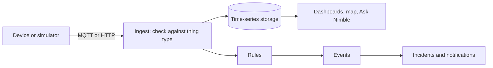

IoT Breeze is the application of the NimBit platform for connected devices. Your devices send measurements, such as a temperature every ten seconds. IoT Breeze stores them, draws them on dashboards and maps, and checks them against rules you define. When a rule fires, it records an event and can notify people.

## What do you want to do?

- **I'm new.** Follow the [Quickstart](./quickstart.mdx). In about 15 minutes you go from nothing to a simulated device, a dashboard and an alert.
- **I want to get something done.** Go to the [documentation home](../index.mdx) and pick a section by the question you have.
- **I need the details.** Open the [API overview](../api/index.mdx).

## Choose your path

- [For operators](./roles/operator.mdx): you watch things and react when something goes wrong.
- [For solution builders](./roles/builder.mdx): you model devices, connect them, and build dashboards and rules.
- [For developers](./roles/developer.mdx): you send data from your own code and read it back through the APIs.
- [For administrators](./roles/administrator.mdx): you decide who can see and do what in the tenant.

## Words you will meet

[Key concepts](./key-concepts.mdx) explains each term in a short paragraph: tenant, thing type, thing, rule, event and the rest.

## Need an account?

You need a tenant to sign in. To get one, contact [info@nimbit.de](mailto:info@nimbit.de).
