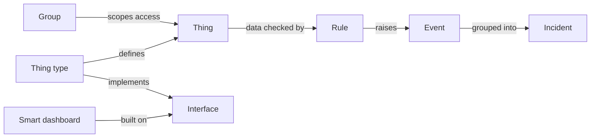

IoT Breeze describes your devices once, as thing types, and then attaches everything else to that description: dashboards, rules, events and access. Learn these terms and the rest of the documentation falls into place.

## Who and where

**[Tenant](../administer/tenant-settings.mdx).** Your company's space in IoT Breeze. Data, users, settings and features belong to one tenant.

**[Organization](../administer/access.mdx).** A group of type Organization: the top of a customer, company or site. Each thing belongs to one organization.

**[Group](../administer/access.mdx).** A node in a tree of people and records. A user sees a thing only if a group of theirs contains it. A role says what the user may do, a group says with which things. Both are needed.

## Describing devices

**[Thing type](../model/things-and-types.mdx).** The model of a kind of device. It lists the measures the device sends and the properties it has. Edits go into a draft; devices use the published version only.

**[Measure](../model/measure-types.mdx).** A value a device sends over time, such as `temperature`, with a type, unit and expected range.

**[Property](../model/measure-types.mdx).** A fixed fact about a device, such as a serial number or a rated flow. It does not change with every message.

**[Interface](../model/things-and-types.mdx).** A reusable set of fields, such as Temperature Sensing. Different thing types can implement the same interface, so one dashboard can serve all of them.

**[Thing](../model/things-and-types.mdx).** One device or asset, such as one sensor in one room. It has a thing type, a unique ID, an organization, groups and its own credentials.

## Getting data in

**[Gateway](../gateways/how-gateways-work.mdx).** One box on site that speaks for many devices with a single credential. It may send only for the things assigned to it. Data enters the platform through tsflux, the ingestion service, and is read back through nbq, the query engine.

**[Periscope](../gateways/periscope/index.mdx).** The edge agent that runs on a machine next to your equipment. It discovers OPC UA, Sparkplug B, MQTT, Modbus, S7 and HTTP sources and streams their values into IoT Breeze.

## Seeing and reacting

**[Dashboard](../visualize/dashboards.mdx).** A page of widgets. Each widget answers one question: how warm is it now, how did it change today, which things are offline.

**[Smart dashboard](../visualize/smart-dashboard.mdx).** A dashboard built on interfaces instead of one device. It works for every thing whose type implements them, today's and tomorrow's. You pick the thing at the top.

**[Rule](../automate/rules-actions-reports.mdx).** A chain of steps built on a canvas: which things to watch, a condition on their data, a trigger that decides how often to act, and the actions to run. An action can raise an event, send an email, call a webhook and more.

**[Event](../watch/events-incidents-notifications.mdx).** A record that something happened: a rule fired, a thing went offline, a record changed. Events are facts, with a severity of Information, Warning, Error or Critical. You cannot edit them.

**[Incident](../watch/events-incidents-notifications.mdx).** A problem that needs a person. It collects related events, so an alarm that fires twenty times is one incident. Someone acknowledges it, works on it and resolves it.

## Knowledge and AI

**[Knowledge graph](../knowledge/knowledge-graph.mdx).** An optional map of your business: things, the places they are in, and other records, with how they relate. A tenant admin switches it on under **Administration › Tenant Settings › Features**.

**[Ask Nimble](../knowledge/ask-nimble-answers.mdx).** The assistant that answers questions in plain words from the knowledge graph, your live readings and your documents, and shows its sources. Open it with Ctrl/⌘+I. It needs the knowledge graph.

## How they work together

You create a thing type, publish it, and create things of that type. Devices send messages that name their thing type; IoT Breeze checks each value against the published schema. Dashboards show the data. Rules watch it and raise events. Policies turn events into incidents, and notifications tell people. Groups decide who sees any of it.

## Related

- [Quickstart](./quickstart.mdx): use each of these once.
- [Glossary](../troubleshooting/glossary.mdx)
