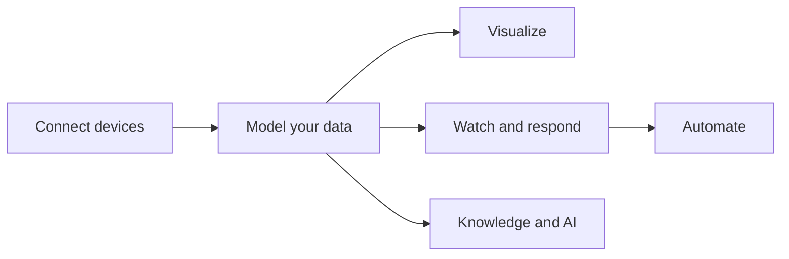

IoT Breeze takes data from your devices, describes it, shows it, watches it and acts on it. The docs follow the same path. Each section answers one question, and every section is laid out the same way: **Understand** first, then **Do**, then **Look up**.

New here? Start with the [Quickstart](./get-started/quickstart.mdx): a simulated device, a dashboard and an alert in about 15 minutes, no hardware needed.

| Section | The question it answers |
| --- | --- |
| [Connect devices](./connect/index.mdx) | How do I get data in? |
| [Model your data](./model/index.mdx) | How do I describe my devices so IoT Breeze understands them? |
| [Visualize](./visualize/index.mdx) | How do I see my data? |
| [Watch and respond](./watch/index.mdx) | What is happening, and what needs me? |
| [Automate](./automate/index.mdx) | How do I make IoT Breeze act for me? |
| [Knowledge and AI](./knowledge/index.mdx) | How do my things relate, and what can I ask? |
| [Administer](./administer/index.mdx) | Who can do what? |
| [Troubleshooting](./troubleshooting/index.mdx) | Something is wrong. Where do I look? |

Building on IoT Breeze from code? The [API](./api/index.mdx) section has the exact contracts.
