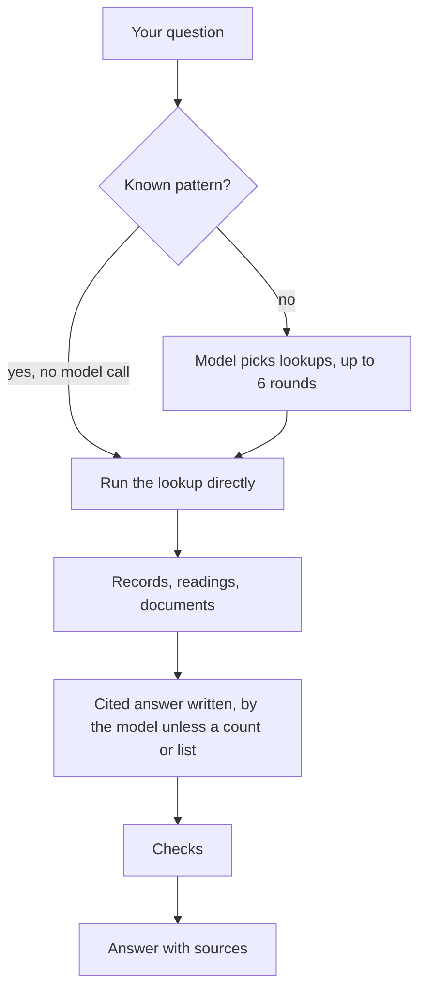

Ask Nimble does not answer from general knowledge. It looks things up in your tenant, as you, and writes an answer only from what it found. Some answers need no AI model at all. The rest use a model, but a set of checks stops numbers, units and citations that the evidence does not back.

## What it reads

Every lookup runs with your own permissions. IoT Breeze forwards your sign-in to the knowledge service, so records you cannot open never reach the answer.

| Source | What Nimble looks up | Switch in the **Reads** strip |
| --- | --- | --- |
| **Records** | Records and places by name, identifier, alias or description; lists by type or location; the hierarchy; relations and paths; incidents. | **Records** |
| **Readings** | The latest value of a measurement, or its values over a time range, from your stored time series. | **Readings** |
| **Docs** | Passages of indexed documents. For a named record, Nimble reads documents about it, its type and its plant or line; **Subtree** widens this to everything below. Without a record it searches all documents you can open. | **Docs** |

Looking up a record by name is always on. Switching a source off in the **Reads** strip removes that kind of lookup for the next question. Nimble does not change anything in your tenant: every lookup only reads.

## How an answer is produced

1. **Recognise.** Nimble first tries to match your question to a known pattern, such as a count by status or a list by location. A match runs the lookup directly and the answer is written from its result, with no model call.
2. **Look up.** Other questions go to the model, which chooses lookups, reads the results and chooses more. A question gets at most six rounds by default.
3. **Write.** The model returns a structured answer. Each sentence points at the evidence behind it.
4. **Check.** The answer is checked before you see it. See below.
5. **Show.** You get the text, the rows, charts or passages it came from, and the steps taken.

A question runs for up to two minutes by default. It also ends when your sign-in is about to expire. Nimble then says so and asks you to ask again.

## Citations

Each `[n]` in the answer points at a source under it.

| Source | Is |
| --- | --- |
| **Graph** | A record or a relation. |
| **Live value** | A reading, with the time it was read. |
| **Document** | A passage of a file, with the page when known. |

An answer with no citation at all is not served. After one repair attempt it is held back.

A list is cited as a set of rows with its exact total. When the list is longer than the sample (25 rows by default), the answer says "N of M" and links to Explore for the rest. An answer that cites a capped list without stating the true total is held back.

## What the checks do

Numbers are the main risk, so the model does not type them. A tool that produces a number hands the model a named value, and the answer refers to that value. Arithmetic, such as a difference or an average, runs in the service, not in the model. The checks then catch:

- a number written into a sentence instead of taken from a value, unless the cited text states it word for word
- a quantity paired with a value of another kind, such as a pressure in hours
- a minimum, average and maximum that contradict each other
- a comparison ("higher than") stated without a computation behind it
- an answer, or a sentence, with no citation

A failed check gets one repair attempt. If it fails again, the offending sentence is dropped and the rest is served, marked as partial, or the whole answer is held back. The answer says why under **Held back**.

## Which model answers

| Setting | Behaviour |
| --- | --- |
| **Auto (default)** | The platform's default model answers: the registered default, or the model the server is configured with. A model your tenant registers does not become the default. |
| A model you pick | In the model menu of the question field, you pin a registered model for the chat. Nothing else is tried. |
| **Fallback order** | In **Auto** only: when the usual model finds nothing (no data, or out of scope), the next model in the chain retries the whole question. At most four models. A stronger model's answer replaces the first only if it improved. |

A model must support tool calling. Without one, counts, lists and lookups still work, and other questions show **This question needs an AI model**. To register or order models, see [Choose the AI model](./ai-model.mdx). **Details** under an answer shows which model answered and how many model calls it took. A count answered by a known pattern shows zero.

The question and the evidence Nimble gathered are sent to the provider of the model that answers. Register only models whose provider your organization approves.

## Limits

- The checks verify numbers, units and citations. They do not verify that the model read the evidence correctly. Open a source when a decision depends on the answer.
- Questions about causes find what changed around the event. Nimble says when a finding is a correlation, not proof.
- It knows only your tenant's records, readings and indexed documents. It has no web access and no knowledge of other tenants.
- A question the evidence cannot answer ends as **I didn't find any matching data.** or **That's outside what I can answer from your graph.**
- A name that matches several records gets a clarifying question, not a guess.
- An empty field cannot be filtered. Nimble says **Not recorded**.
- A document that is not indexed cannot be read. {/* TODO(product): which file types and maximum size does document indexing accept? The source page says PDF, Office, text, Markdown, CSV, HTML up to 50 MB; this is not confirmed in the service code. */}
- Answer quality follows the quality of your graph. See [Data health](./data-health.mdx).

## Related

- [Ask a question about your data](./ask.mdx)
- [Choose the AI model](./ai-model.mdx)
- [The knowledge graph](./knowledge-graph.mdx)
