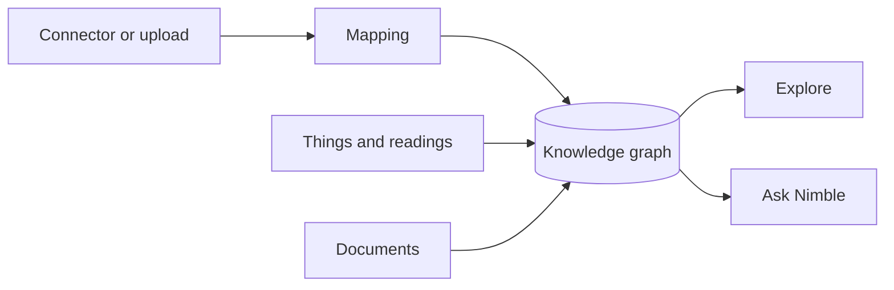

This section answers two questions: how do my things, places and documents relate, and what can I ask about them? The knowledge graph holds the records and their links. Ask Nimble answers questions from that graph, your live readings and your documents, and shows its sources.

:::info This section needs "Ask Nimble and Knowledge" turned on
Two switches must both be on, or **Knowledge** does not appear in the menu and every `/knowledge` page sends you back to Home:

1. **The installation.** Your platform administrator enables it. If it is off, **Administration › Tenant Settings › Features** shows "Not available on this installation".
2. **Your tenant.** A tenant admin opens **Administration › Tenant Settings › Features** and turns on **Ask Nimble and Knowledge**.
:::

## Who can use what

Knowledge has its own permission, separate from the permissions for things and dashboards. Everyone sees only the records they are allowed to open.

| You want to | Permission needed | Built-in roles |
| --- | --- | --- |
| Browse in **Knowledge › Explore** | Read Knowledge | Viewer, Modeler, Manager, Admin |
| Ask in **Knowledge › Ask Nimble** or with Ctrl/⌘+I | Read and run Knowledge | Viewer, Modeler, Manager, Admin |
| Change the graph, the data model, sources, links and the reconciliation schedule | Edit Knowledge | Modeler, Manager, Admin |
| Register models, create or rotate credentials | Edit Knowledge, plus the admin or modeler role; credentials need the tenant admin | Admin, Modeler (models); Admin (credentials) |

Without the edit permission, **Settings › Knowledge setup** is hidden from the menu. You can still read a setup page if you open its link. See [Roles and permissions](../administer/roles.mdx).

## Understand

- [The knowledge graph](./knowledge-graph.mdx): what the graph holds and how records connect.
- [How Ask Nimble answers](./ask-nimble-answers.mdx): what it reads, how it cites, which model answers, and where it stops.

## Do

- [Map your sites and buildings](./map-sites.mdx): build the place hierarchy and put things in it.
- [Ask a question about your data](./ask.mdx): ask, read the sources, give feedback.
- [Bring in an outside data source](./outside-source.mdx): load records from SAP, a database or a file.
- [Fix data-health findings](./data-health.mdx): review links and schedule reconciliation.
- [Choose the AI model](./ai-model.mdx): register a model and set the fallback order.

## Look up

- [Types and traits](./types-and-traits.mdx): the building blocks of a record type.
- [Connector types](./connector-types.mdx): the fields of each connector.
