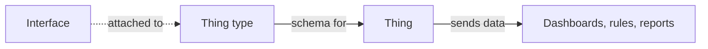

How do I describe my devices so IoT Breeze knows what they send? Define a thing type per kind of device, register each real device as a thing, and share fields between thing types through interfaces. All three are under **Settings › Onboarding**.

## Understand
- [Thing types, things and interfaces](./things-and-types.mdx): what each object is and when you need an interface.
- [Drafts, publishing and versions](./drafts-and-versions.mdx): why your schema edits don't reach devices until you publish.

## Do
- [Create a thing type](./create-thing-type.mdx): define the measures and properties of a kind of device.
- [Register a thing](./register-thing.mdx): add one real device or asset.
- [Reuse an interface across thing types](./reuse-interface.mdx): share fields, map differing names, get Smart dashboards.
- [Clean up incoming data](./clean-up-data.mdx): convert, check or enrich messages before they are stored.

## Look up
- [Measure and property types](./measure-types.mdx): every data type, option and validation rule.
- [Shipped interfaces](./shipped-interfaces.mdx): the interfaces that come with the platform.
