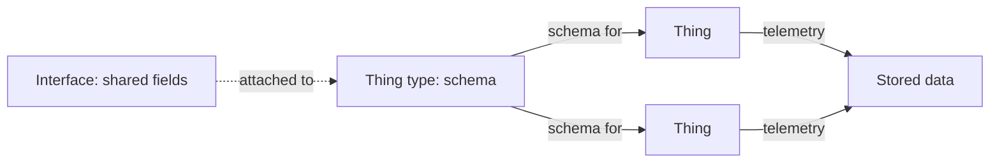

IoT Breeze separates what a kind of device is from the individual devices. A **thing type** defines which values a device sends and which fixed facts it has. A **thing** is one real device that follows a thing type. An **interface** is a set of fields several thing types can share, so one dashboard works for all of them.

## The parts

| Part | What it is | Where |
| --- | --- | --- |
| **Thing type** | The model of a device: its measures and properties, plus settings such as the connector, schema evolution and the cleanup pipeline. | **Settings › Onboarding › Thing Types** |
| **Thing** | One real device or asset. It has a name, an ID the device uses, one thing type, an organization and groups. | **Settings › Onboarding › Things** |
| **Aggregate thing** | A thing without a device, of a thing type of the kind **Aggregate thing**. It holds member things in slots and combines their measures in calculated measures. See [Combine things into an aggregate thing](./aggregate-things.mdx). | **Settings › Onboarding › Things**, **Members** tab |
| **Interface** | A named, versioned set of fields. A thing type that attaches it gets those fields. | **Settings › Onboarding › Interfaces** |
| **Measure** | A value the device sends over time, such as `temperature`. A **calculated measure** is worked out from a formula when it is read; see [Add a calculated measure](./calculated-measures.mdx). | Schema of a thing type or interface |
| **Property** | A fixed fact about the device, such as a serial number or a rated flow. | Schema of a thing type or interface |

Measures and properties are both called fields. The full list of options is in [Measure and property types](./measure-types.mdx).

## How they work together

A thing takes its schema from its thing type. You never edit a measure on a thing, only on the type, and every thing of that type changes with it. A thing's type is fixed when you create it: the **Thing type** field is locked when you edit a thing.

A thing type's schema has two sources. **Own** fields you define on the thing type. **Inherited** fields come from attached interfaces and are read-only there; you change them in the interface.

A thing type that attaches an interface pins one version of it. New versions of the interface don't reach the thing type until you select the update button, for example **Update to v2**. See [Drafts, publishing and versions](./drafts-and-versions.mdx).

A Smart dashboard is built on an interface instead of one device. It shows every thing whose type implements the interface, including devices you add later.

## Choosing between them

| You want… | Use |
| --- | --- |
| Data from one kind of device on a dashboard | A thing type with measures. No interface needed. |
| Different makers' devices on one dashboard | One interface, attached to each thing type. Map fields that have other names. |
| A value that changes over time | A measure. |
| A fixed fact, such as a serial number | A property. |
| A fixed fact to filter or group telemetry by | A property with **Timeseries relevant** on. |
| Fields you already built on a thing type to be shared | **Move to interface** on the thing type. |

## Limits

- A thing type's **Name** and a thing's **Thing Alternate ID** can't be changed after creation.
- A thing type that still has things can't be deleted. Delete the things first.
- An interface that thing types still implement can't be deleted. Detach it everywhere first.
- A preshipped interface is read-only. You can attach it, compare versions and update to a newer one.

## Related

- [Create a thing type](./create-thing-type.mdx) · [Register a thing](./register-thing.mdx) · [Reuse an interface across thing types](./reuse-interface.mdx)
- [Shipped interfaces](./shipped-interfaces.mdx)
