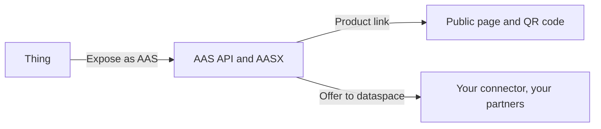

How do I give customers and partners data about my products without giving them access to IoT Breeze? Choose the things to share, publish them as Asset Administration Shells (AAS), and pass them on in one of three ways. All three are off until a tenant admin turns them on, and nothing is shared until you choose it on each thing.

## Do
- [Publish things as Asset Administration Shells](./asset-administration-shell.mdx): serve nameplate, technical data, documents, carbon footprint and time series through the read-only AAS API, and export AASX packages.
- [Create product links and QR codes](./product-links.mdx): a public page per thing or thing type with the fields and documents you choose, and labels to print.
- [Offer things in your dataspace connector](./dataspace-offers.mdx): publish shells as offers in your own EDC connector and keep them in step.
