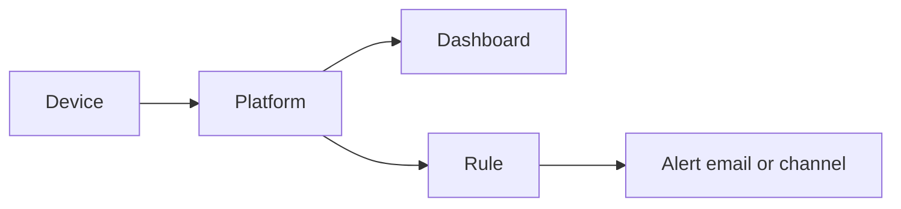

Start from what you see, not from what you built. Each guide lists the checks in the order they most often find the cause, and says what to send to support if none of them does.

## Understand
- [How devices connect](../connect/how-devices-connect.mdx): what happens to a message before it reaches a chart.
- [Events, incidents and notifications](../watch/events-incidents-notifications.mdx): why an event does not always mean a message.

## Do
- [A device shows no signal](./no-signal.mdx): the thing says **No signal yet**, or its last signal is old.
- [A dashboard is empty](./empty-dashboard.mdx): widgets show no values, or the thing you expect is missing.
- [A rule doesn't fire](./rule-not-firing.mdx): the condition should be met but nothing happens.
- [An alert email never arrives](./email-not-arriving.mdx): the event is there, the mail is not.

## Look up
- [Glossary](./glossary.mdx): every term used in IoT Breeze, with a link to the page that explains it.
- [Ingest endpoints and status codes](../connect/ingest-endpoints.mdx) · [Errors and limits](../api/errors-and-limits.mdx)
