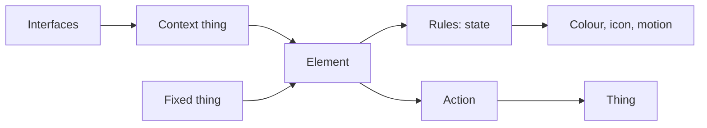

A canvas is a drawing with live data on it. Where a dashboard arranges widgets on a grid, a canvas puts values exactly where the equipment is: on a floor plan, a machine photo or a process drawing. Anyone who opens it sees the plant as it is now, or as it was at an earlier time.

## The parts

| Part | What it is |
| --- | --- |
| **Element** | One item on the canvas: a value, a gauge, a chart, a shape, a symbol, a button. The library holds them in sections: **Data**, **Controls**, **Draw & basic**, **Embeds** and **P&ID symbols**. |
| **Context thing** | The thing a viewer picks in the header. Elements that read **From context** show that thing, so one canvas serves every thing that offers the canvas's interfaces. |
| **Fixed thing** | An element that always reads the same device, whatever the viewer picks. |
| **Binding** | The link from an element to one value: a thing, a measure or a property. Optional **Thresholds** colour it. |
| **State** | A named condition, such as `high alarm`, that **Rules** assign when a value crosses a limit. A state carries a severity and changes colour, icon and motion. |
| **Action** | What happens on click: run a thing's action, open a link or another canvas, switch the context thing, or set a variable. |
| **Kind** | **Monitoring** (values and charts), **P&ID** (a process drawing) or **Managed by Nimbit** (from a template, receives updates). |

## How they work together

**Context or fixed.** In **Canvas settings** you pick the canvas's interfaces. With interfaces, viewers choose a context thing and elements read **From context**. Without them, every element binds to a fixed thing. You can mix both on one canvas.

**Live or history.** A canvas shows live values. A time range in the header shows how values looked then. Choosing a live range brings back current values.

**Alarms.** When a value is in alarm or has gone stale, a chip in the header lists it. Select it to jump to the next one. A value without an update for the stale limit (set per canvas, overridable per element) shows as stale.

**Operating.** Buttons, switches, setpoints and valve actions send commands to real equipment. A canvas does this only when **Allow operation** is on in **Canvas settings**, and each action's own permissions still decide who may run it. Commands usually ask for confirmation first.

**Saved or draft.** You edit in place. Everyone else keeps seeing the saved version until you select **Save**.

## Canvas or dashboard

| You want… | Use… |
| --- | --- |
| Values placed on a picture of the plant | A canvas |
| A grid of charts, tables and figures that people rearrange | A [dashboard](../dashboards.mdx) |
| A process drawing with pumps, valves and tanks | A canvas of kind **P&ID** |
| Both: a drawing beside charts | A canvas, shown on a dashboard with the [Canvas widget](./embed-a-canvas.mdx) |

## Limits

- The editor opens on a larger screen.
- Operation pauses while a past time range is shown, and in a side panel or embed you open the full page to operate.
- A canvas that is too large to save needs elements removed or a split into several canvases.
- A canvas can embed another canvas, up to three levels deep, and never itself.
- Images can be up to 20 MB: PNG, JPG, SVG or WebP.

## Related
- [Draw a floor plan](./draw-a-floor-plan.mdx) · [Canvas editor reference](./editor-reference.mdx)
