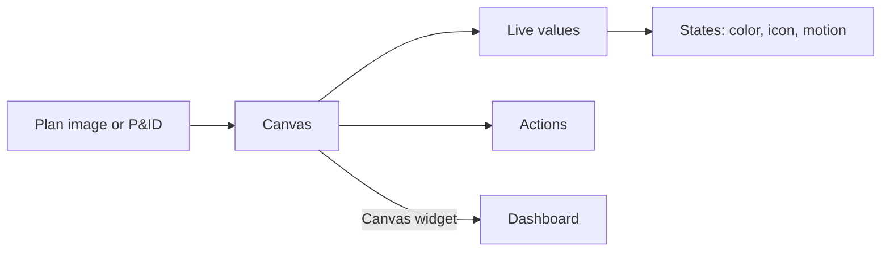

import TourLink from "@site/src/components/TourLink";

A canvas is a drawing of your plant or machine with live values on it. You place values, gauges, charts, shapes and process symbols, bind them to things, and viewers see them update as devices report. Open canvases under **Monitoring › Canvas**.

<TourLink id="canvas" />

## Understand
- [How a canvas works](./how-canvas-works.mdx): what a canvas is, the kinds, how it differs from a dashboard, and how values and actions bind.

## Do
- [Draw a floor plan](./draw-a-floor-plan.mdx): start from a plan image and place live elements on it.
- [Bind elements to live values](./bind-live-values.mdx): choose the thing, the measure and the thresholds.
- [Show state by color, icon and motion](./states-and-colors.mdx): make trouble stand out at a glance.
- [Run actions from a canvas](./actions.mdx): buttons that send a command, open a canvas or switch the thing.
- [Put a canvas on a dashboard](./embed-a-canvas.mdx): show a canvas next to other widgets.

## Look up
- [Canvas editor reference](./editor-reference.mdx): every tool, element, binding option and action type.
