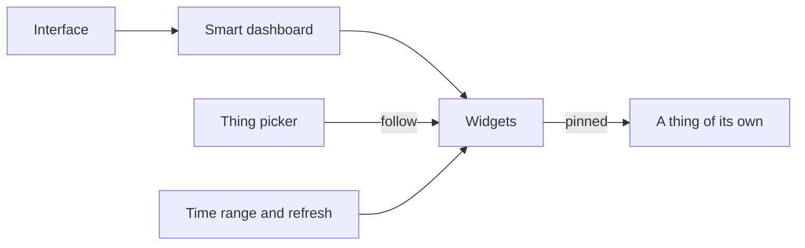

A dashboard is a page of widgets. Each widget answers one question: how warm is it now, how did a value move today, which things are offline. Three things decide what a widget shows: the thing it reads, the time range it covers, and how it refreshes. A bar at the top of the dashboard controls all three for every widget at once.

## The parts

| Part | What it is |
| --- | --- |
| **Smart dashboard** | The dashboard you create today. It matches things through the **interfaces** their thing types implement, so one dashboard serves every fitting thing, now and later. |
| **Interface** | A named set of measures, such as supply and return temperature, that a thing type promises to send. |
| **Widget** | One tile. It reads one thing, or the whole tenant. See the [widget gallery](./widgets.mdx). |
| **Thing picker** | At the top of a Smart dashboard. It chooses the thing that following widgets show. |
| **Time bar** | The time range, the update mode and **Time travel**. |
| **Data source** | **Device** (live values), **Mock data** or **File**, for designing before a device sends data. |
| **Edit mode** | Changes stay a draft until you save. Nobody else sees them before. |

Older dashboard kinds (thing dashboards, thing type dashboards, collections) still exist. You open them from the places they belong to.

## How they work together

### Follow or pin

Each widget reads its data in one of two ways, chosen when you add it.

| Mode | The widget shows | Use it for |
| --- | --- | --- |
| **Follow the dashboard** | Whichever thing is picked at the top. | The same view of every air handler, pump or room. |
| **Its own things** (pinned) | The thing you name, whatever is picked. | One specific thing, such as the outdoor temperature or the main meter. |

A pinned widget shows a pin in its header with the thing's name. One dashboard can hold both.

A thing that implements only some of the dashboard's interfaces can still be picked. It shows its coverage, such as **2 of 3 interfaces**, and widgets on the missing interfaces stay empty.

### Where a dashboard shows up

A dashboard is offered on a thing because it is **assigned**: to the thing, to its thing type, or through a required interface. If a dashboard requires an interface, every thing type with that interface gets the dashboard automatically. A dashboard that needs no thing can go on [Home](./home.mdx).

### Time

Charts and other time-based widgets show the dashboard's time range. Dashboard time is always on.

- **Time range.** Pick a preset from **Last 5 minutes** up to **Last 5 years**, or **Today**, **Yesterday** and other calendar ranges, or set your own start and end. The range is part of the link, so a shared link shows what you see.
- **Default range.** If you change the range while editing, saving asks **Save this time range too?** **Save with range** makes it the dashboard's default. **Dashboard only** keeps the old default.
- **Updates.** **Live mode** shows values as they are reported. **Interval mode** reloads at the **Refresh Rate** you choose. **Manual** reloads when you select the refresh button.
- **Widgets with their own range.** A widget can keep its own range. When some do, the bar reads *N widgets keep their own*. To make one follow the dashboard again, remove the range in the widget's settings.
- **Time travel.** Shows the whole dashboard as it was at an earlier moment. Select **Live** to return to now.

### Mock data and files

Before a device sends data you can design with **Mock data** (patterns **Random**, **Smooth**, **Wave**, **Ramp**, **Steps** and **Spikes**) or with a CSV, Parquet or JSON **File**. Both are read in your browser and nothing is written to a device or its history. Widgets pinned to a thing still show real data.

## Choosing between dashboard kinds

| You want… | Use… |
| --- | --- |
| A view for one specific thing | [A dashboard for one thing](./thing-dashboard.mdx) |
| The same view for every thing of a kind, now and later | [A Smart dashboard on interfaces](./smart-dashboard.mdx) |
| A page for the whole tenant: figures, offline things, shortcuts | A Smart dashboard with no interfaces, [on Home](./home.mdx) |
| A drawing with values on it | A [canvas](./canvas/index.mdx), optionally embedded as a widget |

## Dashboard hierarchy

Optionally, a tenant admin can turn on **Dashboard hierarchy** under **Administration › Tenant Settings › Features**. It is a tree of nodes, such as sites, buildings or areas, to file and browse dashboards. The tree only helps people find dashboards. A dashboard appears on a thing through its assignment, not through its node.

## Limits

- Reading, creating and editing dashboards are separate permissions. A missing button usually means your role lacks one.
- Mock data and files are not stored. After a reload, pick a local file again, or tick **Save a copy to Files**.
- If you refresh again within a few seconds, the app asks you to wait.

## Related

- [Widget gallery](./widgets.mdx) · [Share or embed a dashboard](./share.mdx)
