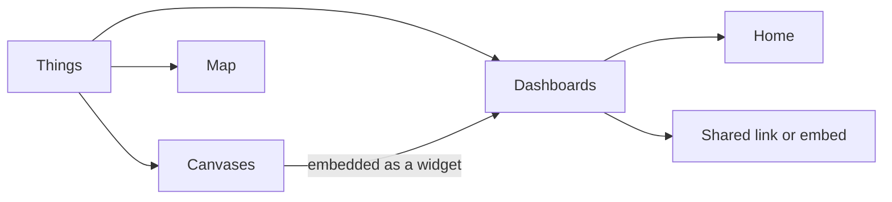

This section answers one question: how do I see my data? A dashboard is a page of widgets, each answering one question about your things. A canvas is a drawing of your plant with live values on it. The map shows where things are.

## Understand
- [Dashboards, smart dashboards and time](./dashboards.mdx): how a dashboard picks its thing, its widgets and its time range.

## Do
- [Build a dashboard for one thing](./thing-dashboard.mdx): create a dashboard, add widgets, arrange and save it.
- [Build one dashboard for every thing of a kind](./smart-dashboard.mdx): follow or pin widgets, assign the dashboard, try it with mock data.
- [Put a dashboard on Home](./home.mdx): show a dashboard to everyone, or only to you, when the app opens.
- [Share or embed a dashboard](./share.mdx): decide who sees it, send a link or embed it in another page.
- [Draw a floor plan with live values](./canvas/index.mdx): place values, gauges and symbols on a picture of your plant.
- [Show things on a map](./map.mdx): find things, filter them and replay where mobile things went.

## Look up
- [Widget gallery](./widgets.mdx): every widget, what it shows and its settings.
