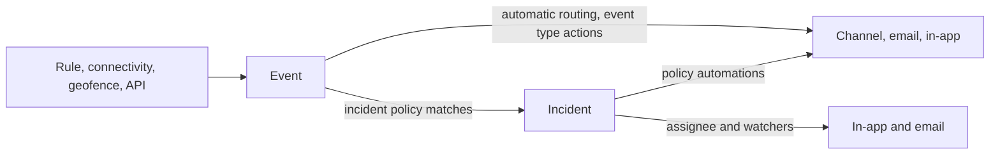

When something goes wrong in your installation, IoT Breeze does three separate things: it records what happened, decides whether a person has to deal with it, and tells people. Keeping these apart is what stops twenty identical alarms from becoming twenty phone calls.

## The parts

| Part | What it is | How many |
| --- | --- | --- |
| **Event** | A record that something happened: a rule matched, a thing went offline, a thing left a geofence, someone changed a record. A fact with a time, a severity and usually a thing. You can't edit it. | Many. Most need nobody. |
| **Incident** | A problem that needs a person. It collects the events that belong together and moves from **Open** to **Closed**. | Few. One per problem. |
| **Incident policy** | The rule that decides which events open an incident, and how events are grouped into one. | A handful per tenant. |
| **Notification** | A message about an event or an incident: in the app, in a channel, or by email. | As many as you route. |

## How they work together

Every event is recorded. You see it under **Monitoring › Events** and on the thing's **Events** tab.

If an incident policy matches the event, the event opens a new incident or joins the open one it belongs to. Without a policy, events never open incidents, though a person can still report one by hand. Someone acknowledges the incident, works on it and resolves it. The incident keeps the history.

Events and incidents reach people by different routes:

- **Events** reach a channel through its **Automatic routing**, or through an action on the event type: **Notification**, **Notification channel**, **Email** or **Webhook**. Both run on every event that matches, so a flapping alarm sends many messages.
- **Incidents** tell their assignee and watchers, in the app and by email, on every change. Nobody is told about what they did themselves, and anyone who muted the incident is skipped. An incident reaches a channel only through an automation on its policy, which runs once per change of state.

A channel's own filters (**Minimum severity** and **Event types**) apply to every message sent to it, however the message got there.

## Choosing between them

| You want… | Use |
| --- | --- |
| A record of what happened | Nothing to set up. Rules, connectivity and geofences create events. |
| Someone to own a problem until it is fixed | An [incident policy](./incident-policy.mdx). |
| Every warning or error in your team's chat | A [notification channel](./alert-channels.mdx) with automatic routing. |
| One chat message per problem, even if the alarm flaps | An automation on the incident policy. |
| An email to a particular person or list | An **Email** action on the event type. |

## Limits

- Email is not a channel. Email goes out through an **Email** action, and incident emails go to the assignee and watchers.
- Events that end a state, such as a thing coming back online, run no event type actions and are not routed to channels.
- Incident notifications are never routed by **Automatic routing**. Use a policy automation.

## Related

- [Work an incident](./work-an-incident.mdx)
- [Event types](./event-types.mdx)
- [Channel types](./channel-types.mdx)
