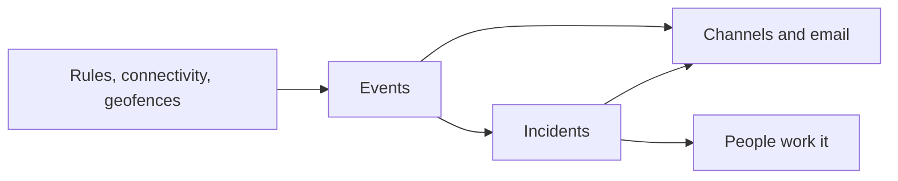

import TourLink from "@site/src/components/TourLink";

This section answers two questions: what is happening, and what needs me? You check things, read what happened and work incidents every day. You set up incident policies, notification channels and mail templates once, so problems reach the right people.

<TourLink id="find-your-way-watch" />

You open the pages below from **Monitoring** in the menu. Setup pages are under **Settings › Configuration**. You only see the entries your role allows.

## Understand

- [Events, incidents and notifications](./events-incidents-notifications.mdx): what is recorded, what needs a person, and who is told.

## Do

- [Check a thing's health](./thing-health.mdx): is it connected, when did it last report, what happened to it.
- [Explore telemetry over time](./explore-telemetry.mdx): chart measures from any things and save the chart.
- [Work an incident](./work-an-incident.mdx): acknowledge, assign, resolve.
- [Set up an incident policy](./incident-policy.mdx): decide which events open incidents and who is told.
- [Send alerts to Teams, Slack or a webhook](./alert-channels.mdx): post warnings and errors into a chat channel.
- [Draw a geofence](./geofence.mdx): raise events when a thing enters or leaves an area.

## Look up

- [Event types](./event-types.mdx): event sources, severities, display types and actions.
- [Incident states and fields](./incident-fields.mdx): the workflow, statuses, reasons and custom fields.
- [Channel types](./channel-types.mdx): fields, routing filters and delivery of each channel.
- [Mail templates and placeholders](./mail-templates.mdx): contexts, blocks and assignment.

Rules that create events from device data are built under Automation. See [Rules, actions and reports](../automate/rules-actions-reports.mdx).
