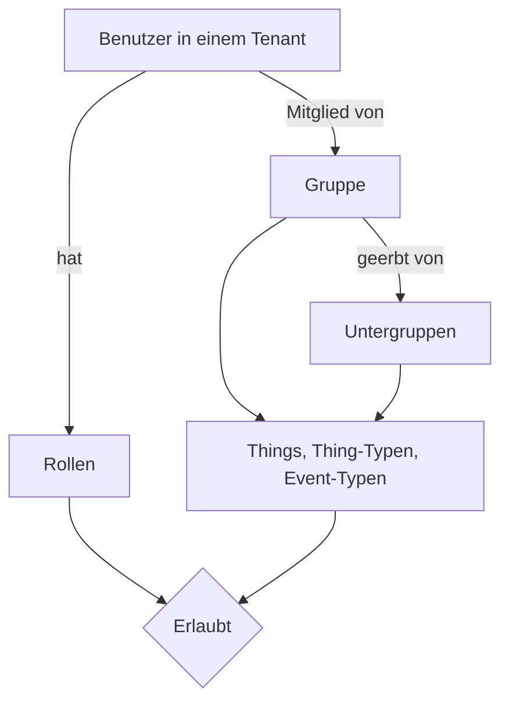

Zwei Dinge bestimmen, was eine Person in IoT Breeze tun darf: ihre **Rollen** und ihre **Gruppen**. Rollen legen fest, welche Arten von Aktionen sie ausführen darf, etwa Things bearbeiten oder Dashboards erstellen. Gruppen legen fest, für welche Things diese Aktionen gelten. Eine Person braucht beides: Eine Rolle ohne Gruppe erreicht nichts, und eine Gruppe ohne Rolle gibt kein Recht zu handeln.

## Die Bausteine {#the-parts}

| Baustein | Was es ist | Bestimmt |
| --- | --- | --- |
| **Benutzer** | Eine Person, die sich an Ihrem Tenant angemeldet hat. | Allein nichts. Trägt Rollen und Gruppenmitgliedschaften. |
| **Rolle** | Ein benannter Satz von Berechtigungen, zum Beispiel „darf Things aktualisieren“. Es gibt vier Systemrollen; Sie können eigene hinzufügen. | Welche Art von Aktion: erstellen, lesen, aktualisieren, löschen, ausführen, je Ressourcentyp. |
| **Gruppe** | Ein Container für Benutzer und für die Things, Thing-Typen und Event-Typen, mit denen sie arbeiten. Gruppen bilden einen Baum. | Welche Things, Thing-Typen und Event-Typen eine Person erreicht. |
| **Gruppenmitgliedschaft** | Ein Benutzer in einer Gruppe, mit den Schaltern **Gelesen**, **Aktualisieren** und **Ausführen**. | Was die Person mit dem Inhalt der Gruppe tun darf: ansehen, ändern, Aktionen darauf ausführen. |
| **Organisation** | Eine Gruppe vom Typ **Organisation**. Ein Thing verzeichnet eine Organisation. | Für sich nichts. Siehe [Organisationen](#organizations). |

## Wie sie zusammenwirken {#how-they-work-together}

**Rollen addieren sich.** Ein Benutzer mit mehreren Rollen hat die Vereinigung ihrer Berechtigungen. Rollen gelten je Tenant: Dieselbe Person kann in einem Tenant **Administrator** sein und in einem anderen **Viewer**.

**Gruppen begrenzen die Things.** Ein Benutzer sieht ein Thing, wenn eine dieser Bedingungen zutrifft:

- Das Thing liegt in einer Gruppe oder in einer Untergruppe einer Gruppe, in der der Benutzer **Gelesen** hat.
- Der Thing-Typ des Things liegt in einer solchen Gruppe. Der Benutzer sieht dann jedes Thing dieses Typs.
- Der Benutzer hat Zugriff auf genau dieses Thing erhalten.
- Der Benutzer hat das Thing selbst erstellt.

**Untergruppen erben.** Eine Mitgliedschaft in einer Gruppe gilt für jede Gruppe darunter. Ein Benutzer in `Customer A` erreicht auch `Customer A / Berlin` und alles darunter. Ein Benutzer in `Berlin` erreicht `Customer A` nicht. Ist ein Benutzer auf mehreren Ebenen desselben Zweigs Mitglied, addieren sich die Schalter: **Aktualisieren** in der übergeordneten Gruppe und **Gelesen** in einer Untergruppe ergeben beides in der Untergruppe. Der Tab **Benutzer** der Gruppe kennzeichnet solche Mitglieder mit **Vererbt**.

**Beide Prüfungen müssen bestehen.** Um ein Thing zu ändern, braucht der Benutzer eine Rolle, die das Aktualisieren von Things erlaubt, und **Aktualisieren** in einer Gruppe, die es enthält. Um einen Befehl darauf auszuführen, müssen Rolle und Gruppe beide **Ausführen** erlauben.

## Organisationen {#organizations}

Eine Organisation ist eine gewöhnliche Gruppe mit dem Typ **Organisation**. Sie markiert die Spitze eines Kunden, Unternehmens oder Standorts in Ihrem Gruppenbaum, und Sie wählen sie im Feld **Organisation** eines Things.

Wenn Sie an einem Thing eine Organisation wählen, halten Sie fest, zu welchem Kunden oder Standort es gehört. Das gibt niemandem Zugriff. Der Zugriff kommt weiter aus den Gruppen, in denen das Thing liegt. Legen Sie das Thing zusätzlich in die Gruppe der Organisation, wenn die Personen in dieser Gruppe es sehen sollen.

{/* TODO(product): The Organization permission exists in the role matrix. What does it control: creating and editing organization-type groups, or something else? */}

## Wann Sie was nehmen {#choosing-between-them}

| Sie möchten … | Nehmen Sie |
| --- | --- |
| dass jemand nur die Things eines Kunden sieht | Eine Gruppe je Kunde. Legen Sie die Person und die Things hinein. |
| dass eine Person alle Kunden sieht | Fügen Sie sie der übergeordneten Gruppe hinzu, oder jeder Kundengruppe. |
| dass jemand beobachten, aber nie ändern darf | Die Rolle **Viewer**. Siehe [Rollen und Berechtigungen](./roles.mdx). |
| dass jemand Aktionen auf Things ausführen, sie aber nicht bearbeiten darf | Eine Rolle, die **Ausführen** erlaubt, und **Ausführen** ohne **Aktualisieren** in der Gruppe. |
| dass eine Person ein einzelnes Thing sieht | Geben Sie ihr dieses Thing, wenn Sie sie [einladen](./invite.mdx), oder fügen Sie das Thing einer Gruppe hinzu, in der sie ist. |
| einen Rechtesatz, den keine der vier Systemrollen bietet | Eine benutzerdefinierte Rolle. Systemrollen lassen sich nicht ändern. |

## Grenzen {#limits}

- Der Tenant-Eigentümer lässt sich nicht entfernen. Der letzte Benutzer mit der Rolle **Administrator** lässt sich nicht entfernen und verliert diese Rolle nicht.
- Sie können nur eine Rolle vergeben, oder eine Berechtigung in einer benutzerdefinierten Rolle, die Sie selbst haben.
- Wenn Sie einen Benutzer aus einer Gruppe entfernen oder eine Gruppe löschen, entfällt der Zugriff, den sie gegeben hat. Die Things selbst bleiben.
- Die Tenant-Auswahl bei der Anmeldung sagt „Organisation“, wo sie den Tenant meint. Eine Gruppe vom Typ **Organisation** ist etwas anderes.

## Verwandte Seiten {#related}

- [Rollen und Berechtigungen](./roles.mdx)
- [Einen Kollegen einladen](./invite.mdx)
- [Einem Team Zugriff auf seine Things geben](./team-access.mdx)
