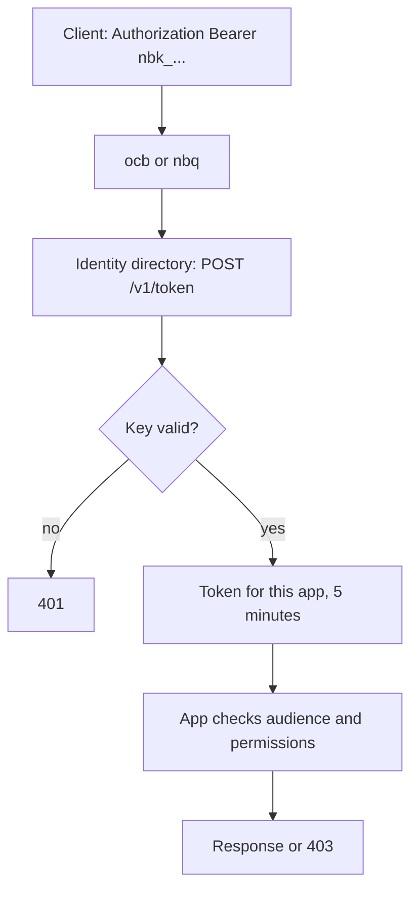

Ein API-Schlüssel ist ein Geheimnis, mit dem ein Skript, eine Integration oder ein KI-Assistent IoT Breeze aufrufen kann, ohne dass sich eine Person anmeldet. Er handelt als ein Mitglied Ihrer Organisation, darf nur tun, was seine Scopes erlauben, und läuft ab.

Ein Schlüssel sieht so aus: `nbk_<key id>_<secret><checksum>`. Die Key-ID ist das öffentliche Kennzeichen, das Sie in Listen und Logs sehen. IoT Breeze speichert nur einen Hash des Geheimnisses, deshalb wird der vollständige Schlüssel nur einmal angezeigt, beim Anlegen.

## Die Bestandteile {#the-parts}

### Arten von Maschinen-Zugangsdaten {#kinds-of-machine-credential}

| Art | Handelt als | Hinweise |
| --- | --- | --- |
| Persönlicher Schlüssel | Sie | Hat nie mehr Rechte als Sie. Läuft immer innerhalb eines Jahres ab. Funktioniert nicht mehr, wenn Sie kein nutzbares Mitglied mehr sind. Die Tenant-Richtlinie kann persönliche Schlüssel abschalten. |
| Service-Account-Schlüssel | Ein Service-Account | Der Account ist ein Mitglied, das sich nie anmeldet und die Rollen hält, die Sie ihm geben. Seine Schlüssel überstehen Personalwechsel. Ihm können Scopes erlaubt werden, die als **Sensibel** markiert sind, und, wenn die Richtlinie kein Maximum setzt, kein Ablauf. |
| Gateway-Zugangsdaten | Ein Gateway | Kein `nbk_`-Schlüssel. Eine Box wie Periscope löst einen einmaligen Onboarding-Code ein und signiert ihre Requests dann mit einem eigenen Schlüsselpaar. Verwaltet auf der Gateway-Seite, siehe [Geräte über ein Gateway verbinden](../gateways/index.mdx). |

Zwei Dinge sehen ähnlich aus und sind verschieden. **Verbundene Apps** auf der Seite der API-Schlüssel sind KI-Assistenten, denen Sie über einen Zustimmungsdialog erlaubt haben, in Ihrem Namen zu handeln. Gerätezugangsdaten (Basic und JWT) gehören zu einem Thing und senden nur Daten; siehe [Authentifizierung](./authentication.mdx#device-and-tenant-credentials-tsflux).

### Scopes {#scopes}

Ein Scope ist ein benannter Berechtigungssatz, der zu einer App gehört. Sie haken Scopes an, wenn Sie einen Schlüssel anlegen. Beispiele aus dem Katalog:

| Scope | App | Label |
| --- | --- | --- |
| `ocb:read` | OCB | Read the platform |
| `things:write`, `rules:manage`, `dashboards:manage`, `reports:run`, `files:manage`, `events:write` | OCB | Manage or write the named area |
| `users:manage` | OCB | Sync members. Sensitive. |
| `telemetry:read` | nbq | Read time series |
| `events:read` | nbq | Read events |

Der Dialog zum Anlegen listet die Scopes, die Ihnen zur Verfügung stehen. Er bietet auch Vorlagen an: **Nur lesen**, **KI-Assistent** und **ERP- oder MES-Integration**.

### Schlüsselrichtlinie {#key-policy}

Admins legen unter **Richtlinie bearbeiten** vier Regeln für die Organisation fest: ob Mitglieder persönliche Schlüssel anlegen dürfen, die maximale Laufzeit, wie lange ein ungenutzter Schlüssel ruhen darf, bevor er nicht mehr funktioniert, und ob Service-Accounts sensible Scopes halten dürfen. Ohne gespeicherte Richtlinie gelten diese Standardwerte: höchstens ein Jahr, persönliche Schlüssel erlaubt, keine sensiblen Scopes, kein Limit für Inaktivität. Die Richtlinie gilt bei jedem Request, nicht nur beim Anlegen.

## Wie sie zusammenarbeiten {#how-they-work-together}

Ein Schlüssel wird nicht als langlebiges Token an die APIs gesendet. Trifft ein Request mit `Authorization: Bearer nbk_...` ein, bittet ocb oder nbq das Identity Directory, den Schlüssel gegen ein Access-Token zu tauschen, das fünf Minuten gültig ist, und prüft dieses Token dann wie das einer Person.

Das Directory lehnt den Schlüssel mit einer einzigen Antwort ab, `401`, wenn er fehlerhaft, unbekannt, widerrufen, abgelaufen, länger als das Richtlinienlimit inaktiv, von einer Adresse genutzt wird, die nicht unter **Erlaubte Adressen** steht, oder sein Principal kein nutzbares Mitglied mehr ist. Andernfalls trägt das Token die Berechtigungen des Besitzers, eingeschränkt auf die Scopes des Schlüssels, und eine Audience, die eine App nennt. Die App lehnt ein Token ab, das für eine andere App gedacht ist.

Weil ein Token für eine App gilt, bekommt ein Schlüssel mit Scopes für mehrere Apps ein Token pro App. ocb und nbq erledigen das für Sie, wenn Sie den Schlüssel als Bearer senden. Der Austausch selbst steht in [Authentifizierung](./authentication.mdx#api-key-exchange).

OCB-Routen, die Berechtigungen deklarieren, werden anhand dieser Berechtigungen entschieden. Routen, die für angemeldete Personen gedacht sind, antworten mit `403` und `API_KEY_NOT_ALLOWED`. Von ihnen steht nur `GET /users/me` Schlüsseln offen.

## Den passenden Schlüssel wählen {#choosing-between-keys}

| Sie möchten | Verwenden |
| --- | --- |
| Ein Skript eine Zeit lang als Sie selbst ausführen | Einen persönlichen Schlüssel mit der Vorlage **Nur lesen** oder den Scopes, die Sie brauchen. |
| Eine Integration betreiben, die Personalwechsel überdauern muss | Einen Service-Account-Schlüssel. |
| Eine Periscope-Box in einem Anlagennetz verbinden | Gateway-Zugangsdaten. |
| Gerätedaten senden | Die Gerätezugangsdaten des Things, keinen Schlüssel. |
| Selbst in IoT Breeze arbeiten | Melden Sie sich an. Kein Schlüssel nötig. |

## Laufzeit und Rotation {#lifetime-and-rotation}

Ein Schlüssel läuft nach 30, 90 oder 365 Tagen ab. **Nie** wird nur für Service-Account-Schlüssel angeboten, wenn die Richtlinie kein Maximum setzt. Kein Access-Token überlebt seinen Schlüssel. Um einen Schlüssel ohne Unterbrechung zu ersetzen, rollen Sie ihn: Der neue Schlüssel hat dieselben Scopes, und der alte funktioniert für einen Zeitraum weiter, den Sie wählen. Widerrufen beendet einen Schlüssel endgültig, und Clients, die ihn verwenden, funktionieren nach spätestens fünf Minuten nicht mehr. Die Schritte stehen unter [Einen API-Schlüssel anlegen](../administer/api-key.mdx#rotate-or-revoke-a-key).

## Schlüssel sicher aufbewahren {#keep-keys-safe}

- Speichern Sie Schlüssel in einem Secret Manager. Präfix `nbk_` und Prüfsumme lassen Secret-Scanner einen geleakten Schlüssel erkennen.
- Legen Sie pro Integration einen Schlüssel an, damit Sie einen widerrufen können, ohne andere zu stören.
- Wählen Sie die kleinste Scope-Menge. Bevorzugen Sie **Nur lesen** und fügen Sie Scopes hinzu, wenn Sie sie brauchen.
- Setzen Sie **Erlaubte Adressen** auf die Netze, aus denen die Integration läuft.
- Verwenden Sie kurze Laufzeiten und rollen Sie vor dem Ablauf.
- Rufen Sie die APIs von einem Server aus auf. Der Schlüsselaustausch sendet keine CORS-Header, deshalb kann eine Browserseite keinen Schlüssel verwenden.

## Limits {#limits}

- Ein Schlüssel funktioniert mit OCB, nbq und den KI-Endpoints. Zum Senden von Daten an tsflux oder MQTT funktioniert er nicht.
- Der Austausch ist ratenbegrenzt. Siehe [Fehler und Limits](./errors-and-limits.mdx#limits).
- API-Schlüssel müssen für Ihr Deployment aktiviert sein. Sind sie aus, antwortet der Austausch mit `404`.

## Verwandte Seiten {#related}

- [Einen API-Schlüssel anlegen](../administer/api-key.mdx) · [Authentifizierung](./authentication.mdx) · [Fehler und Limits](./errors-and-limits.mdx)
