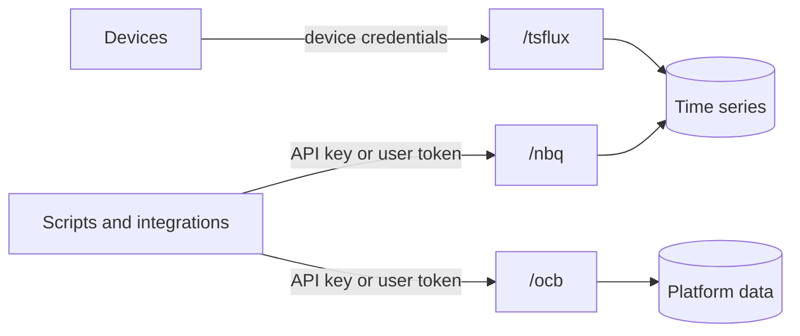

IoT Breeze hat drei HTTP-APIs: Eine nimmt Gerätedaten entgegen, eine liest Zeitreihen und Events aus, und eine verwaltet die Plattform selbst.

## Welche API wofür {#which-api-for-what}

| API | Pfadpräfix | Verwenden Sie sie, um | Akzeptiert |
| --- | --- | --- | --- |
| Ingest-API (tsflux) | `/tsflux` | Gerätenachrichten als JSON, InfluxDB Line Protocol oder InfluxDB-kompatible Writes zu senden. | Geräte- oder Tenant-Zugangsdaten (Basic, JWT). Keine API-Schlüssel. |
| Query-API (nbq) | `/nbq` | Zeitreihen, Snapshots, Positionen, Events und Metriken zu lesen. | API-Schlüssel, Benutzer-Access-Tokens. |
| Plattform-API (OCB) | `/ocb` | Things, Thing-Typen, Regeln, Dashboards, Benutzer und den Rest des Tenants zu verwalten. | API-Schlüssel, Benutzer-Access-Tokens. |

Die OCB-REST-API liegt unter `/ocb/rest/v2`. Die APIs tsflux und nbq liegen nach dem Präfix unter `/api/v1`, zum Beispiel `/tsflux/api/v1/message/structured`.

{/* TODO(product): The repository's legacy compose stack still routes `/dip` to the older GoDIP service. Is `/dip` served in production, and should it be documented? */}

## Verstehen {#understand}

- [API-Schlüssel](./api-keys.mdx): was ein Schlüssel ist, welche Arten es gibt und wie ein Request mit Schlüssel geprüft wird.

## Anwenden {#do}

- [Einen API-Schlüssel anlegen](../administer/api-key.mdx): der Klickweg in IoT Breeze und ein erster Aufruf zum Testen.
- [Alarme an Teams, Slack oder einen Webhook senden](../watch/alert-channels.mdx): IoT-Breeze-Benachrichtigungen in Ihrem eigenen System empfangen.

## Nachschlagen {#look-up}

- [Authentifizierung](./authentication.mdx): Base-URL und alle Zugangsdaten, die jede API akzeptiert, mit exakten Headern.
- [Webhook-Payloads](./webhooks.mdx): was IoT Breeze sendet und wie Sie die Signatur prüfen.
- [Fehler und Limits](./errors-and-limits.mdx): Fehlerformate, Statuscodes, Raten- und Größenlimits.
- [Ingest-API-Referenz](/api/reference/tsflux), [Query-API-Referenz](/api/reference/nbq), [Plattform-API-Referenz](/api/reference/ocb): jeder Endpoint, aus den OpenAPI-Spezifikationen erzeugt.
