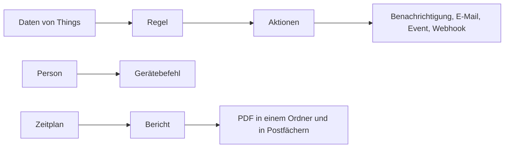

Dieser Bereich beantwortet eine Frage: Wie lasse ich die Plattform handeln, ohne dass jemand ein Dashboard beobachtet? Eine Regel reagiert auf eingehende Daten, ein Gerätebefehl reagiert auf eine Person, und ein Bericht läuft nach der Uhr.

## Verstehen {#understand}
- [Regeln, Aktionen und Berichte](./rules-actions-reports.mdx): was jede Automatisierung tut und die drei verschiedenen Listen von „Aktionen“.

## Umsetzen {#do}
- [Alarmieren, wenn ein Wert eine Grenze überschreitet](./threshold-alert.mdx): sich selbst benachrichtigen, wenn eine Temperatur über 25 °C steigt.
- [Einen Befehl an ein Gerät senden](./device-command.mdx): einen MQTT-Befehl definieren und von einer Thing-Seite oder einem Dashboard aus auslösen.
- [Aus einer Regel ein anderes System aufrufen](./webhook-from-rule.mdx): einer Regel eine Webhook-Aktion hinzufügen.
- [Einen wöchentlichen PDF-Bericht per E-Mail senden](./weekly-report.mdx): einen Bericht erstellen, planen und Abonnenten hinzufügen.

## Nachschlagen {#look-up}
- [Regelbedingungen und Funktionen](./conditions.mdx): einfache und erweiterte Bedingungen, Operatoren, Fensterfunktionen.
- [Aktionstypen](./action-types.mdx): jede Aktion, die Sie hinzufügen können, danach geordnet, wo Sie sie hinzufügen.
- [Berichtseinstellungen](./report-settings.mdx): jedes Feld eines Berichts und seines Zeitplans.
- [Node-RED](./node-red.mdx): der externe Flow-Editor.
