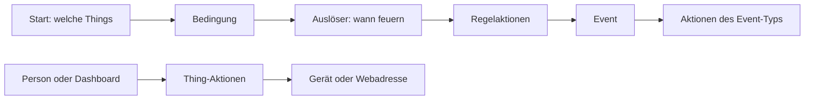

IoT Breeze automatisiert auf drei Arten. Eine Regel beobachtet eingehende Daten und führt Aktionen aus, wenn eine Bedingung zutrifft. Ein Gerätebefehl ist eine Aktion, die eine Person bewusst auslöst. Ein Bericht erzeugt nach Zeitplan ein PDF. Das Wort „Aktion“ kommt an allen drei Stellen vor, und die Listen der Aktionstypen sind jeweils andere.

## Die Bausteine {#the-parts}

| Baustein | Was es ist | Wo Sie es bauen |
| --- | --- | --- |
| **Regel** | Eine Kette aus vier Knoten: **Start**, **Bedingung**, **Auslöser**, **Aktionen**. Sie wird jedes Mal ausgewertet, wenn ein Thing im Geltungsbereich Daten sendet. | **Einstellungen › Automatisierung › Regel-Designer** |
| **Regelaktion** | Ein Schritt, den eine Regel ausführt, wenn ihr Auslöser feuert. | Der Knoten **Aktionen** einer Regel |
| **Aktion eines Event-Typs** | Ein Schritt, der jedes Mal läuft, wenn ein Event dieses Typs entsteht, egal was es erzeugt hat, außer bei Events, die eine Episode beenden. Sie startet ausgeschaltet: Schalten Sie nach dem Anlegen **Aktiv** ein. | Tab **Aktionen** eines Event-Typs unter **Einstellungen › Konfiguration › Event Typen** |
| **Thing-Aktion** | Ein Befehl, der einmal an einem Thing-Typ oder Thing definiert und von einer Person oder einem Dashboard ausgelöst wird. | Tab **Aktionen** eines Thing-Typs oder Things |
| **Bericht** | Ein Dokument aus Widgets, das IoT Breeze zu PDF rendert, in einem Ordner ablegt und an Abonnenten sendet. | **Einstellungen › Automatisierung › Berichte** |

## Drei Listen von Aktionen {#three-lists-of-actions}

Jeder Ort bietet eine andere Auswahl. [Aktionstypen](./action-types.mdx) enthält die Felder jedes Typs.

| Wo | Aktionstypen |
| --- | --- |
| Regel | **Benachrichtigung**, **Benachrichtigungskanal**, **E-Mail**, **Webhook**, **Ereignis**, **Telemetrien aktualisieren** |
| Event-Typ | **Benachrichtigung**, **Benachrichtigungskanal**, **E-Mail**, **Webhook** |
| Thing-Typ oder Thing | **Webhook**, **Azure C2D**, **MQTT** |

Eine Regel kann keine Thing-Aktion wie einen MQTT-Befehl auslösen. Eine Regel kann mit ihrer Aktion **Ereignis** ein Event erzeugen, und das Event führt dann die Aktionen seines Event-Typs aus. So kommen Sie von einer Regel zu allem, was ein Event-Typ tut, einschließlich Vorfällen und Kanal-Routing.

## Wie sie zusammenwirken {#how-they-work-together}

Eine Regel wertet eine Bedingung bei jeder Nachricht der Things in ihrem Knoten **Start** aus. Der **Auslöser** bestimmt, wie aus dem Ergebnis ein Feuern wird: jeder Treffer, erst nachdem die Bedingung eine Weile galt, einmal pro Zeitraum oder nur bei einem Zustandswechsel. Erst dann laufen die Aktionen.

Die meisten Alarmierungen nutzen eine Regel mit einer Aktion **Ereignis**. Das Event wird aufgezeichnet, eine [Vorfallsrichtlinie](../watch/incident-policy.mdx) kann es zu einem Vorfall bündeln, und Benachrichtigungskanäle mit automatischem Routing greifen es auf. Siehe [Events, Vorfälle und Benachrichtigungen](../watch/events-incidents-notifications.mdx).

Ein Bericht ist von Regeln unabhängig. Er liest Daten wie ein Dashboard, über ein Fenster, das Sie festlegen, nach seinem eigenen Zeitplan.

## Wann Sie was nehmen {#choosing-between-them}

| Sie möchten … | Nehmen Sie |
| --- | --- |
| eine Nachricht an sich oder eine Gruppe, wenn ein Wert eine Grenze überschreitet | Eine Regel mit einer Aktion **Benachrichtigung**: [Alarmieren, wenn ein Wert eine Grenze überschreitet](./threshold-alert.mdx) |
| dass ein anderes System aufgerufen wird, wenn eine Bedingung zutrifft | Eine Regel mit einer Aktion **Webhook**: [Aus einer Regel ein anderes System aufrufen](./webhook-from-rule.mdx) |
| eine Aufzeichnung und Vorfallsbearbeitung, mehr als eine Nachricht | Eine Regel mit einer Aktion **Ereignis**, dann eine Vorfallsrichtlinie |
| dass ein Gerät etwas tut, wenn eine Person es entscheidet | Eine Thing-Aktion: [Einen Befehl an ein Gerät senden](./device-command.mdx) |
| jede Woche zur selben Zeit dieselbe Zusammenfassung | Einen Bericht: [Einen wöchentlichen PDF-Bericht per E-Mail senden](./weekly-report.mdx) |
| Logik, die Bedingungen und Auslöser nicht ausdrücken können | [Node-RED](./node-red.mdx), falls Ihr Administrator es aktiviert hat |

## Grenzen {#limits}

- Der Regel-Canvas und der Berichts-Editor brauchen einen Desktop-Browser.
- Es ist immer nur eine Version einer Regel aktiv.
- **Telemetrien aktualisieren** funktioniert nur, wenn der Knoten **Start** der Regel einen Thing-Typ verwendet, nicht Tags.
- E-Mails gehen über die Aktion **E-Mail** raus. Ein Benachrichtigungskanal kann keine E-Mail-Adresse sein.

## Verwandte Seiten {#related}

- [Regelbedingungen und Funktionen](./conditions.mdx)
- [Aktionstypen](./action-types.mdx)
- [Berichtseinstellungen](./report-settings.mdx)
