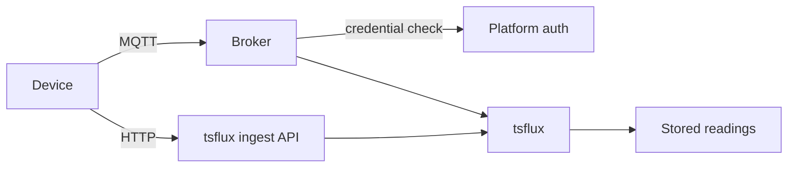

A device connects to IoT Breeze with credentials that belong to one thing. It can send data over MQTT or HTTP, and the platform accepts data only for that thing. Every message is checked against the thing's thing type before it is stored.

## The parts

| Part | What it does |
| --- | --- |
| Thing | One device or asset, with an ID, a thing type and credentials. |
| Thing type | Decides which measures are accepted. A message names it in `thingType`. |
| Credential | Proves the device's identity: a basic username and password, or a JWT token. Both are signed by the thing's **Device key**. |
| Broker | The MQTT endpoint. It asks the platform to check the credential and then limits the device to its own topics. |
| tsflux | The ingestion service. It reads MQTT messages and serves the HTTP endpoints. It checks, resolves and stores each message. |

## How they work together

The same credential works on both protocols. Over MQTT it is checked once, when the client connects, and the broker then confines the device to its own topics. Over HTTP it is checked on every request.

tsflux then looks up the thing and its thing type. A message is stored when the thing exists, the thing type matches, and at least one value or a location is left after the checks. A measure that is not in the published thing type is dropped, unless the thing type has **Auto Schema Evolution** on. In that case the measure is added to the thing type and a new version is published at once. See [Drafts, publishing and versions](../model/drafts-and-versions.mdx).

## Choosing between protocols

| You want | Use |
| --- | --- |
| A permanent connection, low overhead, commands sent back to the device | [MQTT](./mqtt.mdx) |
| To send from a script, a server or a device that only speaks HTTP, with an answer for each request | [HTTP](./http.mdx) |
| To keep an InfluxDB client, Telegraf or an existing line protocol writer | [Line protocol](./line-protocol.mdx) |
| To test without hardware | [Simulate a device](./simulate.mdx) |
| Many devices behind one box on site | A gateway or Periscope. See [Gateways](../gateways/index.mdx). |

Commands travel only over MQTT, and only to a device that is connected at that moment.

## Limits

| Limit | Value |
| --- | --- |
| MQTT versions and QoS | 3.1.1, QoS 0 and 1. |
| HTTP body | 10 MB. |
| Where the port and TLS setting come from | Your deployment. **Gateway url** in **Connection info** shows them. |

## Related

- [MQTT topics and client ID](./mqtt-topics.mdx) · [Ingest endpoints and status codes](./ingest-endpoints.mdx)
- [Thing types, things and interfaces](../model/things-and-types.mdx)
