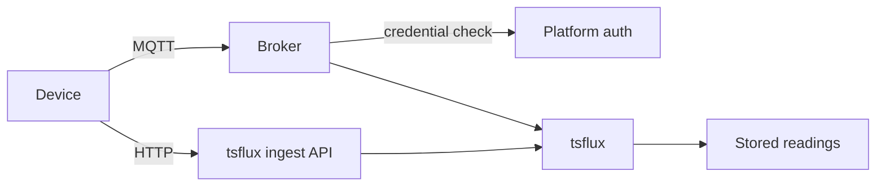

Ein Gerät verbindet sich mit IoT Breeze über Zugangsdaten, die zu genau einem Thing gehören. Es kann Daten über MQTT oder HTTP senden, und die Plattform nimmt nur Daten für dieses Thing an. Jede Nachricht wird vor dem Speichern gegen den Thing-Typ des Things geprüft.

## Die Bestandteile {#the-parts}

| Bestandteil | Aufgabe |
| --- | --- |
| Thing | Ein Gerät oder Asset mit ID, Thing-Typ und Zugangsdaten. |
| Thing-Typ | Legt fest, welche Messwerte akzeptiert werden. Eine Nachricht nennt ihn in `thingType`. |
| Zugangsdaten | Weisen die Identität des Geräts nach: Benutzername und Passwort (Basic) oder ein JWT-Token. Beide werden mit dem **Geräteschlüssel** des Things signiert. |
| Broker | Der MQTT-Endpoint. Er lässt die Plattform die Zugangsdaten prüfen und beschränkt das Gerät dann auf seine eigenen Topics. |
| tsflux | Der Ingestion-Dienst. Er liest MQTT-Nachrichten und stellt die HTTP-Endpoints bereit. Er prüft, löst auf und speichert jede Nachricht. |

## Wie sie zusammenarbeiten {#how-they-work-together}

Dieselben Zugangsdaten funktionieren mit beiden Protokollen. Über MQTT werden sie einmal geprüft, beim Verbinden des Clients, und der Broker beschränkt das Gerät danach auf seine eigenen Topics. Über HTTP werden sie bei jedem Request geprüft.

tsflux schlägt dann das Thing und seinen Thing-Typ nach. Eine Nachricht wird gespeichert, wenn das Thing existiert, der Thing-Typ passt und nach den Prüfungen mindestens ein Wert oder ein Standort übrig bleibt. Ein Messwert, der nicht im veröffentlichten Thing-Typ steht, wird verworfen, es sei denn, beim Thing-Typ ist **Auto-Schemas Entwicklung** eingeschaltet. Dann wird der Messwert dem Thing-Typ hinzugefügt und sofort eine neue Version veröffentlicht. Siehe [Entwürfe, Veröffentlichen und Versionen](../model/drafts-and-versions.mdx).

## Das passende Protokoll wählen {#choosing-between-protocols}

| Sie möchten | Verwenden |
| --- | --- |
| Eine dauerhafte Verbindung, wenig Overhead, Befehle zurück an das Gerät | [MQTT](./mqtt.mdx) |
| Aus einem Skript, von einem Server oder einem Gerät senden, das nur HTTP spricht, mit einer Antwort pro Request | [HTTP](./http.mdx) |
| Einen InfluxDB-Client, Telegraf oder einen vorhandenen Line-Protocol-Writer weiterverwenden | [Line Protocol](./line-protocol.mdx) |
| Ohne Hardware testen | [Ein Gerät simulieren](./simulate.mdx) |
| Viele Geräte hinter einer Box vor Ort | Ein Gateway oder Periscope. Siehe [Gateways](../gateways/index.mdx). |

Befehle laufen nur über MQTT und nur zu einem Gerät, das in diesem Moment verbunden ist.

## Grenzen {#limits}

| Grenze | Wert |
| --- | --- |
| MQTT-Versionen und QoS | 3.1.1, QoS 0 und 1. |
| HTTP-Body | 10 MiB. |
| Woher Port und TLS-Einstellung kommen | Von Ihrem Deployment. Die **Gateway-URL** unter **Verbindungsinformationen** zeigt sie. |

## Verwandte Seiten {#related}

- [MQTT-Topics und Client-ID](./mqtt-topics.mdx) · [Ingest-Endpoints und Statuscodes](./ingest-endpoints.mdx)
- [Thing-Typen, Things und Interfaces](../model/things-and-types.mdx)
