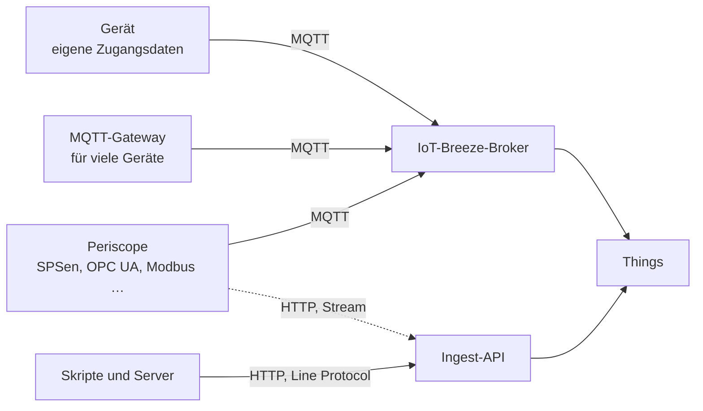

Dieser Bereich beantwortet eine Frage: Wie bekomme ich Daten hinein? MQTT ist der Hauptweg. Ein einzelnes Gerät verbindet sich mit seinen eigenen Zugangsdaten mit dem IoT-Breeze-Broker. Ein Gateway verbindet sich mit einem Satz Zugangsdaten und sendet für alle Geräte dahinter. Periscope, der Edge-Agent, ist so ein Gateway. HTTP und InfluxDB Line Protocol gibt es für Skripte und für Writer, die Sie schon haben.

## Ihren Weg wählen {#pick-your-path}

| Sie haben | Beginnen Sie hier |
| --- | --- |
| Ein Gerät, das seine eigenen Daten sendet | [Daten über MQTT senden](./mqtt.mdx) |
| Eine Box, die für viele Geräte sendet und MQTT spricht, etwa einen eWON Flexy | [Daten vieler Geräte über ein MQTT-Gateway senden](../gateways/mqtt-gateway.mdx) |
| Maschinen und Feldnetze: SPSen, OPC-UA-Server, Modbus-Geräte | [Periscope](../gateways/periscope/index.mdx), eingerichtet als [Gateway](../gateways/add-a-gateway.mdx) |
| Ein Skript, ein Server oder ein Gerät, das nur HTTP spricht | [Daten über HTTP senden](./http.mdx) |
| Einen InfluxDB-Client oder Telegraf | [InfluxDB Line Protocol schreiben](./line-protocol.mdx) |
| Noch keine Hardware | [Ein Gerät simulieren](./simulate.mdx) |

## Verstehen {#understand}
- [Wie Geräte sich verbinden](./how-devices-connect.mdx): Zugangsdaten, die Wege zum Broker und was mit einer Nachricht passiert.
- [Wie Gateways funktionieren](../gateways/how-gateways-work.mdx): ein Satz Zugangsdaten für eine Box, die für viele Geräte spricht.

## Anwenden {#do}
- [Daten über MQTT senden](./mqtt.mdx): Telemetrie mit mosquitto_pub, Python oder Node.js veröffentlichen.
- [Gerätezugangsdaten anlegen und rotieren](./credentials.mdx): Basic-Zugangsdaten, Tokens und der Geräteschlüssel.
- [Ein Gerät simulieren](./simulate.mdx): Dashboards und Regeln ohne Hardware testen.
- [Daten über HTTP senden](./http.mdx): JSON mit curl, Python oder Node.js senden.
- [InfluxDB Line Protocol schreiben](./line-protocol.mdx): Zeilen schreiben oder einen InfluxDB-Client auf tsflux richten.

## Nachschlagen {#look-up}
- [MQTT-Topics und Client-ID](./mqtt-topics.mdx): Broker, Client-IDs, Topics und QoS, für Geräte und Gateways.
- [Nachrichtenformat](./message-format.mdx): jedes Feld einer Nachricht.
- [Ingest-Endpoints und Statuscodes](./ingest-endpoints.mdx): URLs, Authentifizierung und Antworten.
