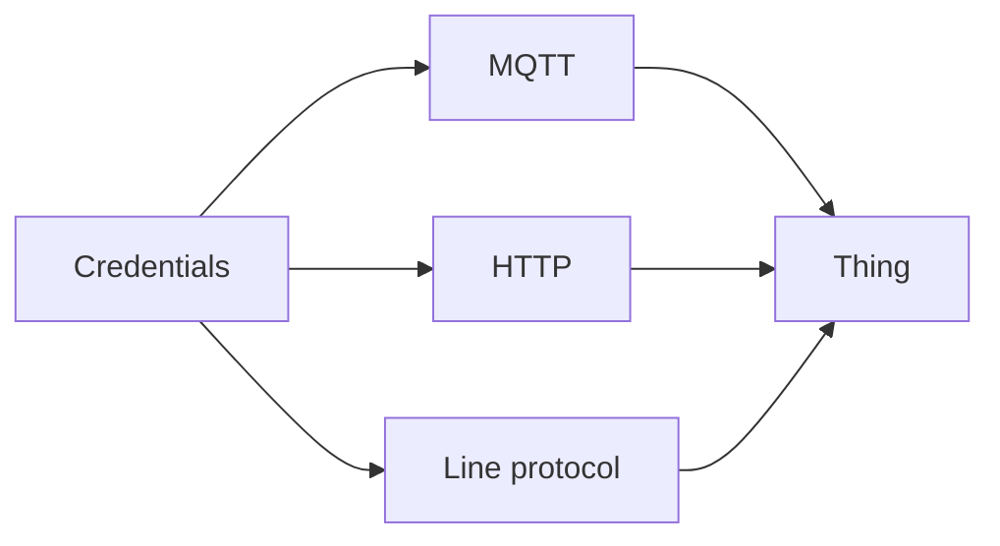

Dieser Bereich beantwortet eine Frage: Wie bekomme ich Daten hinein? Er behandelt Zugangsdaten, die drei Wege, auf denen ein Gerät Daten sendet, das Testen ohne Hardware und die genauen Topics, Endpoints und Felder.

## Verstehen {#understand}
- [Wie Geräte sich verbinden](./how-devices-connect.mdx): Zugangsdaten, Protokolle und was mit einer Nachricht passiert.

## Anwenden {#do}
- [Daten über MQTT senden](./mqtt.mdx): Telemetrie mit mosquitto_pub, Python oder Node.js veröffentlichen.
- [Daten über HTTP senden](./http.mdx): JSON mit curl, Python oder Node.js senden.
- [InfluxDB Line Protocol schreiben](./line-protocol.mdx): Zeilen schreiben oder einen InfluxDB-Client auf tsflux richten.
- [Ein Gerät simulieren](./simulate.mdx): Dashboards und Regeln ohne Hardware testen.
- [Gerätezugangsdaten anlegen und rotieren](./credentials.mdx): Basic-Zugangsdaten, Tokens und der Geräteschlüssel.
- Über eine Box vor Ort verbinden: [Gateways](../gateways/index.mdx).

## Nachschlagen {#look-up}
- [Nachrichtenformat](./message-format.mdx): jedes Feld einer Nachricht.
- [MQTT-Topics und Client-ID](./mqtt-topics.mdx): Broker, Client-ID, Topics und QoS.
- [Ingest-Endpoints und Statuscodes](./ingest-endpoints.mdx): URLs, Authentifizierung und Antworten.
