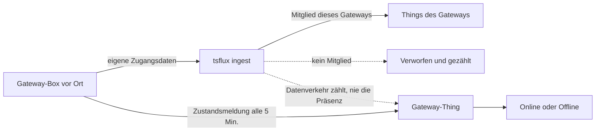

Ein Gateway ist eine Box vor Ort, die für viele Geräte spricht. Statt jedem Gerät eigene Zugangsdaten zu geben, vergeben Sie der Box eine einzige. Die Plattform lässt diese Zugangsdaten nur Daten für die Things senden, die dem Gateway zugeordnet sind, und beobachtet den eigenen Heartbeat der Box, um Ihnen zu zeigen, ob sie lebt.

## Die Bausteine {#the-parts}

| Baustein | Was es ist |
| --- | --- |
| **Gateway** | Ein Eintrag in Ihrer Organisation mit Name, Typ, Namespace und Scope. Sie verwalten ihn unter **Geräte › Gateways**. |
| **Typ** | **Periscope**: ein [Periscope](./periscope/index.mdx)-Agent, der sich mit einem eigenen Schlüssel anmeldet. **MQTT-Gerät**: ein Gerät, das sich per MQTT mit Benutzername und Passwort verbindet, zum Beispiel ein eWON Flexy. |
| **Gateway-Thing** | Ein Thing, das IoT Breeze zusammen mit dem Gateway anlegt, mit der Alternate-ID `gateway-<gateway id>`. Sein Verbindungsstatus ist der Status des Gateways. Es wird mit dem Gateway entfernt. Niemand kann es einzeln löschen: **Löschen** ist deaktiviert und zeigt **Wird mit seinem Gateway entfernt**. |
| **Namespace** | Das Präfix der Alternate-IDs der Things des Gateways: Sie entsprechen dem Namespace oder beginnen mit `<namespace>-`. IoT Breeze leitet ihn aus dem Namen ab, wenn Sie keinen eingeben. Bei **Periscope**-Gateways wird er durchgesetzt. Bei einem Gateway vom Typ **MQTT-Gerät** wird er beim Zuordnen von Things nicht geprüft. |
| **Bereich** (Scope) | Was das Gateway haben darf: Things innerhalb seines Namespace (Periscope), von den erlaubten Thing-Typen, bis zu einem Thing-Limit. Das **Anlegen von Things** ist **Offen** oder **Gesperrt**. |
| **Zugehörigkeit** | Ein Thing gehört zu höchstens einem Gateway. Maßgeblich ist der Eintrag, nicht der Weg, auf dem die Daten ankamen. Siehe [Die Things hinter einem Gateway verwalten](./things-behind-a-gateway.mdx). |

## Wie sie zusammenarbeiten {#how-they-work-together}

**Anmelden.** Für ein Periscope-Gateway erhalten Sie einen einmaligen Onboarding-Code. Die Box löst ihn einmal ein, erzeugt ein eigenes Schlüsselpaar und meldet sich danach mit diesem Schlüssel an. Für ein MQTT-Gerät erhalten Sie einen Broker-Benutzernamen und ein Passwort, die nur einmal angezeigt werden, sowie eine Konfigurationsdatei, die beides enthält.

**Daten senden.** Über MQTT dürfen die Zugangsdaten eines Gateways nur auf Topics veröffentlichen, die die eigene Gateway-ID enthalten. Ein MQTT-Gerät kann pro Thing senden oder einen Batch für mehrere Things; siehe [Daten vieler Geräte über ein MQTT-Gateway senden](./mqtt-gateway.mdx). Über HTTP und Stream-Ingest nennt das Token eines Periscope-Gateways das Gateway. Für jede Nachricht prüft die Plattform dann, ob das Thing zum Gateway gehört. Eine Nachricht für ein Thing eines anderen Gateways, für ein nicht existierendes Thing oder eine fehlerhafte Nachricht wird verworfen und nach Grund gezählt. Siehe [Zustand und Datenverkehr von Gateways prüfen](./fleet-health.mdx).

**Things anlegen.** Eine Periscope-Box legt ihre Thing-Typen und Things selbst an, und jedes Thing, das sie anlegt, trägt die Kennung des Gateways. Ein MQTT-Gerät hat keinen API-Zugriff und seine Nachrichten legen nie Things an, daher legen Sie seine Things in IoT Breeze an und ordnen sie dem Gateway zu. Ein **gesperrtes** Gateway legt auf keinem Weg neue Things an. Things, die es schon hat, arbeiten weiter.

**Am Leben sein.** Das Gateway-Thing wird **Online**, wenn die eigene Zustandsmeldung der Box eintrifft, also alle 5 Minuten, und **Offline**, wenn 15 Minuten lang keine kommt. Die Datenverkehrszahlen der Plattform werden in dasselbe Thing geschrieben, setzen es aber nie auf online, sodass eine tote Box nicht lebendig wirken kann. Jedes Thing hinter einem Gateway hat seinen eigenen Timeout, ein Gateway kann also online sein, während ein Gerät dahinter offline ist. Siehe [Präsenz von Things hinter einem Gateway](./things-behind-a-gateway.mdx#presence-of-things-behind-a-gateway).

**Ein Gateway aussperren.** Widerrufen Sie einen Schlüssel, stellen Sie neue MQTT-Zugangsdaten aus oder löschen Sie das Gateway. Eine neue Anmeldung wird sofort abgelehnt. Eine bereits verbundene MQTT-Sitzung endet innerhalb von zehn Minuten. Die HTTP- und Stream-Token einer Periscope-Box gelten höchstens zehn Minuten. Siehe [Gateway widerrufen, ersetzen oder entfernen](./revoke-and-replace.mdx).

## Ist eine Periscope-Instanz ein Gateway? {#is-a-periscope-instance-a-gateway}

Nur wenn Sie sie mit einem Onboarding-Code einrichten. Dann ist sie ein Gateway vom Typ **Periscope**: Sie hat einen Eintrag, ein Gateway-Thing, einen Namespace und einen Scope und darf nur für ihre eigenen Things senden.

Ein Periscope-Agent kann auch als Servicekonto laufen (E-Mail und Passwort, einmal registriert). Dieser Agent ist kein Gateway. Er hat keinen Eintrag, keinen Namespace und kein Gesundheits-Thing und sendet mit Zugangsdaten für den ganzen Tenant. Verwenden Sie für neue Installationen den Onboarding-Code.

## Was wann? {#choosing-between}

| Sie haben | Verwenden Sie |
| --- | --- |
| Eine Maschine neben der Anlage, auf der Periscope laufen kann | Ein **Periscope**-Gateway. Es erkennt Quellen und legt Things an. |
| Ein Gerät, das MQTT spricht und keine Software von uns ausführen kann | Ein Gateway vom Typ **MQTT-Gerät**. Sie modellieren die Things in IoT Breeze. Für einen eWON Flexy siehe [eWON Flexy anbinden](./ewon-flexy.mdx). |
| Ein Gerät, das nur seine eigenen Daten sendet | Kein Gateway. [Senden Sie Daten per MQTT](../connect/mqtt.mdx) mit Gerätezugangsdaten. |

## Limits {#limits}

- Höchstens 1000 Periscope-Gateways pro Organisation.
- Ein Thing gehört zu höchstens einem Gateway.
- Ein MQTT-Gerät kann nur für ein Thing senden, das bereits existiert und dem Gateway zugeordnet ist. Unbekannte Things werden aus seinen Nachrichten nicht angelegt: Sie werden verworfen und als `unknown_thing` gezählt.
- Ein Batch eines MQTT-Gateways umfasst standardmäßig höchstens 1 MiB und 500 Elemente. Eine größere Veröffentlichung wird als Ganzes verworfen. Siehe [Daten vieler Geräte über ein MQTT-Gateway senden](./mqtt-gateway.mdx#batch-limits-and-checks).
- Gateways brauchen API-Schlüssel. Hat Ihr Betreiber sie ausgeschaltet, zeigt die Seite **Gateways sind nicht aktiviert**.

## Verwandte Seiten {#related}

- [Gateway hinzufügen](./add-a-gateway.mdx)
- [Daten vieler Geräte über ein MQTT-Gateway senden](./mqtt-gateway.mdx)
- [Die Things hinter einem Gateway verwalten](./things-behind-a-gateway.mdx)
- [Gateway widerrufen, ersetzen oder entfernen](./revoke-and-replace.mdx)
- [Gateway-Referenz](./gateway-reference.mdx)
- [Thing-Typen, Things und Interfaces](../model/things-and-types.mdx)
