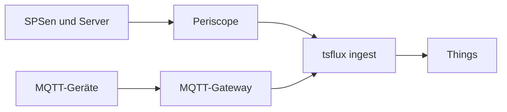

Dieser Bereich beantwortet eine Frage: Wie binde ich Maschinen und Feldnetze an? Ein Gateway ist ein Thing, das für viele Geräte spricht. Periscope ist der Edge-Agent, der neben Ihren Anlagen läuft, deren Quellen erkennt und ihre Werte an IoT Breeze streamt.

## Verstehen {#understand}
- [Wie Gateways funktionieren](./how-gateways-work.mdx): wofür ein Gateway senden darf und woran IoT Breeze erkennt, dass es lebt.
- [Wie Periscope funktioniert](./periscope/how-periscope-works.mdx): Erkennung, Zuordnung und Streaming auf der Edge-Box.

## Umsetzen {#do}
- [Gateway hinzufügen](./add-a-gateway.mdx): ein Periscope-Gateway anlegen und die Box mit einem Code registrieren.
- [Daten vieler Geräte über ein MQTT-Gateway senden](./mqtt-gateway.mdx): eine Zugangsberechtigung für ein Gerät wie einen eWON Flexy.
- [Zustand und Datenverkehr von Gateways prüfen](./fleet-health.mdx): Offline-Gateways und verworfene Nachrichten finden.
- [Periscope installieren und die erste Quelle streamen](./periscope/install.mdx): vom Download bis zu Werten in IoT Breeze.

## Nachschlagen {#look-up}
- [Gateway-Referenz](./gateway-reference.mdx): Felder, Status, Limits, Messwerte und Verwerfungsgründe.
- [Periscope](./periscope/index.mdx): Eingänge, Ausgänge, Konfiguration und Befehle des Edge-Agents.
