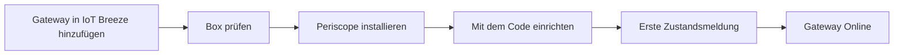

In diesem Bereich betreiben Sie Periscope im Produktivbetrieb auf einer Box und halten es gesund. Er beginnt dort, wo das [Tutorial für die ersten Schritte](../install.mdx) endet: Sie haben es einmal funktionieren sehen und installieren es nun an jedem Standort. Eine Box ist bereit, wenn ihr Gateway in IoT Breeze **Online** zeigt.

Der Weg umfasst fünf Schritte:

1. [Fügen Sie in IoT Breeze ein Gateway hinzu](../../add-a-gateway.mdx) und kopieren Sie seinen Onboarding-Code.
2. Prüfen Sie die Box anhand der [Voraussetzungen](./requirements.mdx).
3. Installieren Sie Periscope [in einem Container](./run-in-a-container.mdx) oder [als Dienst](./run-as-a-service.mdx).
4. [Richten Sie die Box](./onboard.mdx) mit dem Code ein.
5. Warten Sie auf die erste Zustandsmeldung. Sie wird etwa 15 Sekunden gesendet, nachdem der Agent den Namespace seines Gateways kennt, und mit ihrem Eintreffen ist das Gateway **Online**.

## Verstehen {#understand}
- [Was Periscope auf der Box aufbewahrt](./state-and-backup.mdx): die Dateien, die eine Box zum Gateway machen, und was zu sichern ist.
- [Wie Gateways funktionieren](../../how-gateways-work.mdx): Namespace, Bereich und Zustand aus Sicht der Plattform.

## Umsetzen {#do}
- [Periscope in einem Container betreiben](./run-in-a-container.mdx)
- [Periscope als Dienst betreiben](./run-as-a-service.mdx)
- [Eine Box mit einem Onboarding-Code einrichten](./onboard.mdx)
- [Eine Box aktualisieren](./upgrade.mdx): was sich ändert und in welcher Reihenfolge.
- [Eine Box von einem Servicekonto auf ein Gateway umstellen](./move-to-a-gateway.mdx)
- [Eine Box ersetzen](./replace-a-box.mdx)

## Nachschlagen {#look-up}
- [Voraussetzungen für eine Edge-Box](./requirements.mdx): Systeme, Speicherplatz, Netzwerk und Uhr.
- [Konfigurationsreferenz](../configuration.mdx) · [Kommandozeilen-Referenz](../commands.mdx)
