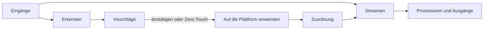

Periscope ist ein einzelnes Go-Binary, das mit einer TOML-Datei konfiguriert wird. Es erledigt über eine Verbindung zu Ihrer Anlage zwei Aufgaben: die Erkennung, die das Modell erzeugt, und das Streaming, das die Werte sendet. Es braucht keine Änderung an anderen Diensten, und nichts muss es erreichen außer den Personen, die seine Web-Oberfläche öffnen.

## Die Bausteine {#the-parts}

| Baustein | Was er tut |
| --- | --- |
| **Eingang** | Liest eine Quelle: OPC UA, Sparkplug B, MQTT oder UNS, Siemens S7, Modbus oder eine HTTP-API. Jeder Eingang hat einen `alias`, und sein Adressraum ist schreibgeschützt. |
| **Snapshot** | Die letzte Erkennung eines Eingangs: Ordner, Objekte und Variablen mit Einheiten, Bereichen und Namen, wo die Quelle sie hat. |
| **Vorschläge** | Thing-Typen, Things und Messwerte, aus dem Snapshot abgeleitet, jeweils mit einem Status. Dieselbe Anlage erzeugt immer dieselben Vorschläge mit denselben IDs. |
| **Zuordnung** | Welche Quelladresse welches Thing und welchen Messwert speist. „Anwenden“ schreibt sie. |
| **Prozessor** | Verändert Werte unterwegs: umbenennen, skalieren, ausdünnen, taggen, konvertieren. |
| **Ausgang** | Sendet Werte an die Plattform: `tsflux_stream`, `tsflux`, `nimbit_mqtt` sowie `file` oder `stdout` für Tests. |
| **State-Verzeichnis** | Alles, was der Agent aufbewahrt: Snapshots, Vorschläge, Änderungen, Zuordnung, Schlüssel, Warteschlangen. |

## Wie sie zusammenarbeiten {#how-they-work-together}

1. **Erkennen.** Jeder Eingang liest seine Quelle und schreibt einen Snapshot. Periscope leitet Vorschläge ab: einen Thing-Typ pro Maschinenart, ein Thing pro Maschine, einen Messwert pro Variable, abgelegt unter Ihrem `mount`-Pfad. Standardmäßig wiederholt es das stündlich.
2. **Bestätigen.** Im Modus `confirm` prüft eine Person die Vorschläge in der Web-Oberfläche, benennt sie um, führt sie zusammen und bestätigt den Rest. Im Modus `zero-touch` wird alles Vorgeschlagene sofort angewendet. Eine erneute Erkennung setzt ein geändertes Element zurück auf `proposed`. Nichts wird stillschweigend umbenannt oder gelöscht.
3. **Anwenden.** Periscope legt die bestätigten Thing-Typen und danach ihre Things in IoT Breeze an und schreibt die Zuordnung. Erneutes Anwenden legt nichts doppelt an.
4. **Streamen.** Eingänge liefern Werte, die Zuordnung weist jeden einem Thing und Messwert zu, Prozessoren verändern sie, und Ausgänge senden sie.
5. **Prüfen.** Sie kontrollieren, dass jedes angewendete Thing Werte erhalten hat. Siehe [Prüfen, ob Daten angekommen sind](./verify.mdx).

`periscope serve` führt all das fortlaufend aus und stellt die Web-Oberfläche und die HTTP-API auf einem Port bereit.

## Ist eine Periscope-Instanz ein Gateway? {#is-a-periscope-instance-a-gateway}

Nur wenn Sie sie mit einem Onboarding-Code aus **Geräte › Gateways** einrichten. Setzen Sie `[ocb] gateway = true`, dann meldet sich der Agent mit seinem eigenen Schlüssel an, sendet mit Zugangsdaten, die das Gateway nennen, und darf nur seine eigenen Things anlegen und aktualisieren. IoT Breeze zeigt ihn als Gateway mit Status, Namespace und Scope. Siehe [Wie Gateways funktionieren](../how-gateways-work.mdx).

Auf einem Gateway tut der Agent außerdem drei Dinge, die der andere Modus nicht tut. Er fragt die Plattform nach dem Datensatz seines Gateways (`gateways.me`) und verwendet dessen Namespace als Präfix jeder Alternate-ID. Bis die Plattform antwortet, erkennt und wendet er nichts an. Er fordert die eigenen Datenzugangsdaten des Gateways für seine Ausgänge an und erneuert die kurzlebigen Tokens, die der Ingest braucht. Und er sendet alle `agent.health_interval` eine Zustandsmeldung, die das Gateway auf **Online** setzt. [Eine Box einrichten](./deploy/onboard.mdx) zeigt die Schritte.

Ohne das läuft der Agent im Servicekonto-Modus: Er meldet sich als Benutzer Ihrer Organisation mit der Rolle `modeler` an, ist kein Gateway und hat kein Gateway-Thing, keinen Namespace und keinen Scope. Neue Installationen sollten ein Gateway verwenden.

| | Gateway-Modus | Servicekonto-Modus |
| --- | --- | --- |
| Anmeldung | Schlüsselpaar, Onboarding-Code | E-Mail und Passwort, einmal registriert |
| Alternate-IDs der Things beginnen mit | Dem Namespace des Gateways | `agent.name` |
| Datenzugangsdaten | Die des Gateways, nur für seine Things gültig | Die des Tenants, für jedes Thing gültig |
| Erscheint unter **Gateways** | Ja | Nein |
| Zustand in IoT Breeze sichtbar | Ja, am Gateway-Thing | Nein |
| Platzierung an Contexus gesendet | Nein, das Token des Gateways gilt nur für das Plattform-Backend | Ja, wenn die Organisation Contexus aktiviert hat |

## Limits {#limits}

- Der Agent liest Quellen und schreibt nie in sie.
- Die Identität eines Things, seine Alternate-ID, beginnt mit `agent.name` – auf einem Gateway mit dem Namespace des Gateways – und kann den eigenen `mount` eines Eingangs enthalten. Jede spätere Änderung legt neue Things an. Der `mount` unter `[ocb]` legt fest, wo die Things liegen, und ist nicht Teil der Alternate-ID.
- Im Gateway-Modus sendet der Agent den Zustand live, nie aus einer Warteschlange, sodass ein nachgesendeter Rückstau einen toten Agenten nicht online halten kann.

## Verwandte Seiten {#related}

- [Periscope installieren und die erste Quelle streamen](./install.mdx)
- [Periscope bereitstellen](./deploy/index.mdx)
- [Konfigurationsreferenz](./configuration.mdx)
- [Gateway hinzufügen](../add-a-gateway.mdx)
