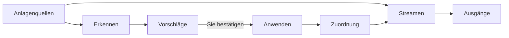

Periscope ist ein Programm, das auf einer Maschine neben Ihren Anlagen läuft. Es liest Ihre Anlage, ohne in sie zu schreiben, schlägt die Thing-Typen und Things vor, die sie beschreiben, legt sie nach Ihrer Bestätigung in IoT Breeze an und streamt dann ihre Werte. In diesem Bereich installieren Sie es, verbinden jede Art von Quelle und schlagen ihre Einstellungen nach.

Der Agent liefert seine vollständige Dokumentation unter `http://<listen>/ui/docs` aus, sodass ein Techniker an der Box sie ohne Internetzugang lesen kann. Dieser Bereich behandelt dasselbe aus Sicht der Plattform.

## Verstehen {#understand}
- [Wie Periscope funktioniert](./how-periscope-works.mdx): die Stufen und ob eine Instanz ein Gateway ist.

## Umsetzen {#do}
- [Periscope installieren und die erste Quelle streamen](./install.mdx): ein Tutorial vom Container bis zu Werten in IoT Breeze.
- [Einen OPC-UA-Server verbinden](./opc-ua.mdx)
- [Modbus-Register lesen](./modbus.mdx)
- [Eine Siemens-S7-SPS lesen](./s7.mdx)
- [Sparkplug B oder einen MQTT-Broker abonnieren](./sparkplug-and-mqtt.mdx)
- [Eine HTTP-Quelle abfragen](./http.mdx)
- [Periscope-Erkennungen freigeben](./approve-discoveries.mdx): Vorschläge umbenennen, zusammenführen und bestätigen.
- [Werte transformieren, bevor sie die Edge verlassen](./processors.mdx)
- [Prüfen, ob Daten angekommen sind](./verify.mdx)
- [Periscope-Probleme beheben](./troubleshooting.mdx)

## Nachschlagen {#look-up}
- [Konfigurationsreferenz](./configuration.mdx): jede Tabelle und jeder Schlüssel von `periscope.toml`.
- [Ausgänge-Referenz](./outputs.mdx): wohin Werte gehen und wie sie gepuffert werden.
- [Kommandozeilen-Referenz](./commands.mdx): jeder `periscope`-Befehl und jeder Exit-Code.
