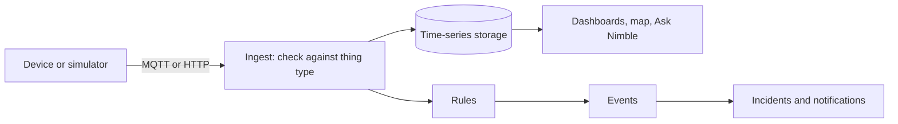

IoT Breeze ist die Anwendung der NimBit-Plattform für vernetzte Geräte. Ihre Geräte senden Messwerte, etwa alle zehn Sekunden eine Temperatur. IoT Breeze speichert sie, zeichnet sie auf Dashboards und Karten und prüft sie gegen Regeln, die Sie festlegen. Löst eine Regel aus, erzeugt sie ein Event und kann Personen benachrichtigen.

## Was möchten Sie tun? {#what-do-you-want-to-do}

- **Ich bin neu hier.** Folgen Sie dem [Quickstart](./quickstart.mdx). In etwa 15 Minuten kommen Sie von nichts zu einem simulierten Gerät, einem Dashboard und einem Alarm.
- **Ich will etwas erledigen.** Gehen Sie zur [Startseite der Dokumentation](../index.mdx) und wählen Sie einen Bereich nach Ihrer Frage.
- **Ich brauche die Details.** Öffnen Sie den [API-Überblick](../api/index.mdx).

## Wählen Sie Ihren Weg {#choose-your-path}

- [Für den Betrieb](./roles/operator.mdx): Sie überwachen Things und reagieren, wenn etwas schiefgeht.
- [Für den Lösungsbau](./roles/builder.mdx): Sie modellieren Geräte, verbinden sie und bauen Dashboards und Regeln.
- [Für die Entwicklung](./roles/developer.mdx): Sie senden Daten aus eigenem Code und lesen sie über die APIs zurück.
- [Für die Administration](./roles/administrator.mdx): Sie legen fest, wer im Tenant was sehen und tun darf.

## Begriffe, die Ihnen begegnen {#words-you-will-meet}

Die [Grundbegriffe](./key-concepts.mdx) erklären jeden Begriff in einem kurzen Absatz: Tenant, Thing-Typ, Thing, Regel, Event und den Rest.

## Brauchen Sie ein Konto? {#need-an-account}

Zum Anmelden brauchen Sie einen Tenant. Schreiben Sie dazu an [info@nimbit.de](mailto:info@nimbit.de).
