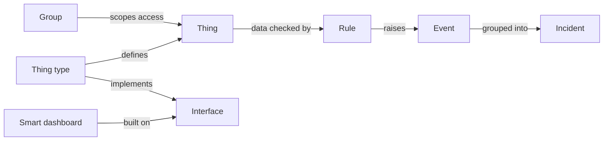

IoT Breeze beschreibt Ihre Geräte einmal als Thing-Typen und hängt alles Weitere an diese Beschreibung: Dashboards, Regeln, Events und Zugriff. Kennen Sie diese Begriffe, ordnet sich der Rest der Dokumentation von selbst.

## Wer und wo {#who-and-where}

**[Tenant](../administer/tenant-settings.mdx).** Der Bereich Ihres Unternehmens in IoT Breeze. Daten, Benutzer, Einstellungen und Funktionen gehören zu einem Tenant.

**[Organisation](../administer/access.mdx).** Eine Gruppe vom Typ Organisation: die Spitze eines Kunden, eines Unternehmens oder eines Standorts. Jedes Thing gehört zu einer Organisation.

**[Gruppe](../administer/access.mdx).** Ein Knoten in einem Baum aus Personen und Datensätzen. Ein Benutzer sieht ein Thing nur, wenn eine seiner Gruppen es enthält. Eine Rolle sagt, was der Benutzer tun darf, eine Gruppe sagt, mit welchen Things. Beides ist nötig.

## Geräte beschreiben {#describing-devices}

**[Thing-Typ](../model/things-and-types.mdx).** Das Modell einer Art von Gerät. Er listet die Messwerte, die das Gerät sendet, und die Eigenschaften, die es hat. Änderungen gehen in einen Entwurf; Geräte verwenden nur die veröffentlichte Version.

**[Messwert](../model/measure-types.mdx).** Ein Wert, den ein Gerät über die Zeit sendet, etwa `temperature`, mit Typ, Einheit und erwartetem Bereich.

**[Eigenschaft](../model/measure-types.mdx).** Eine feste Angabe zu einem Gerät, etwa eine Seriennummer oder ein Nenndurchfluss. Sie ändert sich nicht mit jeder Nachricht.

**[Interface](../model/things-and-types.mdx).** Ein wiederverwendbarer Satz von Feldern, etwa Temperature Sensing. Verschiedene Thing-Typen können dasselbe Interface umsetzen, sodass ein Dashboard für alle taugt.

**[Thing](../model/things-and-types.mdx).** Ein Gerät oder Asset, etwa ein Sensor in einem Raum. Es hat einen Thing-Typ, eine eindeutige ID, eine Organisation, Gruppen und eigene Zugangsdaten.

## Daten hereinholen {#getting-data-in}

**[Gateway](../gateways/how-gateways-work.mdx).** Eine Box vor Ort, die mit einer einzigen Zugangsberechtigung für viele Geräte spricht. Sie darf nur für die ihr zugewiesenen Things senden. Daten gelangen über tsflux, den Ingestion-Dienst, in die Plattform und werden über nbq, die Query-Engine, zurückgelesen.

**[Periscope](../gateways/periscope/index.mdx).** Der Edge-Agent, der auf einem Rechner neben Ihrer Ausrüstung läuft. Er findet OPC-UA-, Sparkplug-B-, MQTT-, Modbus-, S7- und HTTP-Quellen und streamt deren Werte in IoT Breeze.

## Sehen und reagieren {#seeing-and-reacting}

**[Dashboard](../visualize/dashboards.mdx).** Eine Seite aus Widgets. Jedes Widget beantwortet eine Frage: wie warm es jetzt ist, wie es sich heute verändert hat, welche Things offline sind.

**[Smart Dashboard](../visualize/smart-dashboard.mdx).** Ein Dashboard, das auf Interfaces statt auf einem einzelnen Gerät aufbaut. Es funktioniert für jedes Thing, dessen Typ sie umsetzt, heutige wie künftige. Das Thing wählen Sie oben.

**[Regel](../automate/rules-actions-reports.mdx).** Eine Kette von Schritten auf einem Canvas: welche Things beobachtet werden, eine Bedingung auf ihren Daten, ein Trigger, der bestimmt, wie oft gehandelt wird, und die Aktionen, die laufen. Eine Aktion kann ein Event erzeugen, eine E-Mail senden, einen Webhook aufrufen und mehr.

**[Event](../watch/events-incidents-notifications.mdx).** Ein Eintrag, dass etwas passiert ist: eine Regel hat ausgelöst, ein Thing ging offline, ein Datensatz wurde geändert. Events sind Fakten mit dem Schweregrad Information, Warnung, Fehler oder Kritisch. Sie lassen sich nicht bearbeiten.

**[Vorfall](../watch/events-incidents-notifications.mdx).** Ein Problem, das eine Person braucht. Er sammelt zusammengehörige Events, sodass ein Alarm, der zwanzigmal auslöst, ein Vorfall ist. Jemand quittiert ihn, bearbeitet ihn und löst ihn.

## Knowledge und KI {#knowledge-and-ai}

**[Knowledge Graph](../knowledge/knowledge-graph.mdx).** Eine optionale Karte Ihres Geschäfts: Things, die Orte, an denen sie stehen, und weitere Datensätze, mit ihren Beziehungen. Ein Tenant-Admin schaltet sie unter **Arbeitsbereich › Arbeitsbereich-Einstellungen › Funktionen** ein.

**[Ask Nimble](../knowledge/ask-nimble-answers.mdx).** Der Assistent, der Fragen in einfachen Worten aus dem Knowledge Graph, Ihren Live-Messwerten und Ihren Dokumenten beantwortet und seine Quellen zeigt. Öffnen Sie ihn mit Strg/⌘+I. Er braucht den Knowledge Graph.

## Wie sie zusammenarbeiten {#how-they-work-together}

Sie legen einen Thing-Typ an, veröffentlichen ihn und legen Things dieses Typs an. Geräte senden Nachrichten, die ihren Thing-Typ nennen; IoT Breeze prüft jeden Wert gegen das veröffentlichte Schema. Dashboards zeigen die Daten. Regeln beobachten sie und erzeugen Events. Richtlinien machen aus Events Vorfälle, und Benachrichtigungen informieren Personen. Gruppen bestimmen, wer davon etwas sieht.

## Verwandte Seiten {#related}

- [Quickstart](./quickstart.mdx): jeden dieser Begriffe einmal verwenden.
- [Glossar](../troubleshooting/glossary.mdx)
