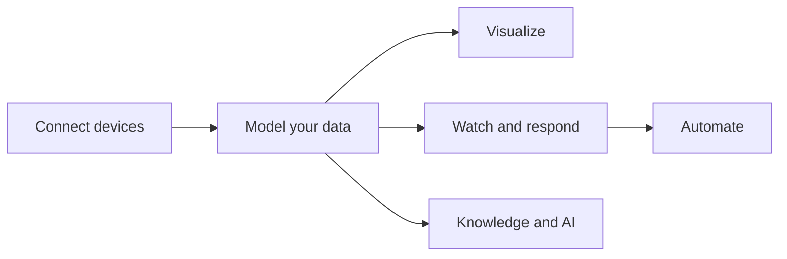

IoT Breeze übernimmt Daten von Ihren Geräten, beschreibt sie, zeigt sie, überwacht sie und handelt danach. Die Doku folgt demselben Weg. Jeder Bereich beantwortet eine Frage und ist gleich aufgebaut: erst **Verstehen**, dann **Erledigen**, dann **Nachschlagen**.

Neu hier? Beginnen Sie mit dem [Quickstart](./get-started/quickstart.mdx): ein simuliertes Gerät, ein Dashboard und ein Alarm in etwa 15 Minuten, ohne Hardware.

| Bereich | Die Frage, die er beantwortet |
| --- | --- |
| [Geräte verbinden](./connect/index.mdx) | Wie kommen meine Daten rein? |
| [Gateways und Edge](./gateways/index.mdx) | Wie binde ich Maschinen und Feldnetze an? |
| [Daten modellieren](./model/index.mdx) | Wie beschreibe ich meine Geräte, damit IoT Breeze sie versteht? |
| [Visualisieren](./visualize/index.mdx) | Wie sehe ich meine Daten? |
| [Überwachen und reagieren](./watch/index.mdx) | Was passiert gerade, und was braucht mich? |
| [Automatisieren](./automate/index.mdx) | Wie lasse ich IoT Breeze für mich handeln? |
| [Knowledge und KI](./knowledge/index.mdx) | Wie hängen meine Things zusammen, und was kann ich fragen? |
| [Verwalten](./administer/index.mdx) | Wer darf was? |
| [Fehlerbehebung](./troubleshooting/index.mdx) | Etwas stimmt nicht. Wo suche ich? |

Sie bauen mit Code auf IoT Breeze auf? Der Bereich [API](./api/index.mdx) enthält die genauen Verträge.
