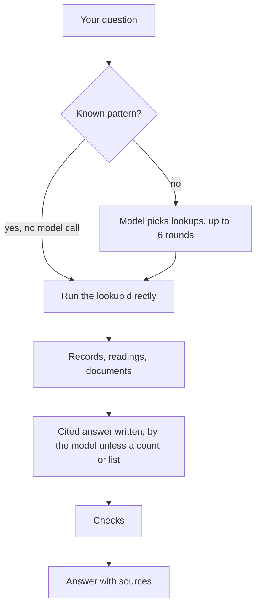

Ask Nimble antwortet nicht aus Allgemeinwissen. Es schlägt in Ihrem Tenant nach, als Sie, und schreibt eine Antwort nur aus dem, was es gefunden hat. Manche Antworten brauchen gar kein KI-Modell. Die übrigen nutzen eines, aber eine Reihe von Prüfungen hält Zahlen, Einheiten und Quellenangaben zurück, die die Belege nicht stützen.

## Was es liest {#what-it-reads}

Jede Abfrage läuft mit Ihren eigenen Berechtigungen. IoT Breeze reicht Ihre Anmeldung an den Knowledge-Dienst weiter, daher erreichen Datensätze, die Sie nicht öffnen dürfen, nie die Antwort.

| Quelle | Was Nimble nachschlägt | Schalter in der Leiste **Liest** |
| --- | --- | --- |
| **Einträge** | Datensätze und Orte nach Name, Kennung, Alias oder Beschreibung; Listen nach Typ oder Ort; die Hierarchie; Beziehungen und Pfade; Vorfälle. | **Einträge** |
| **Messwerte** | Der letzte Wert einer Messung oder ihre Werte über einen Zeitraum, aus Ihren gespeicherten Zeitreihen. | **Messwerte** |
| **Dokumente** | Abschnitte indizierter Dokumente. Bei einem genannten Datensatz liest Nimble Dokumente zu ihm, zu seinem Typ und zu seinem Werk oder seiner Linie; **Teilbaum** erweitert das auf alles darunter. Ohne Datensatz durchsucht es alle Dokumente, die Sie öffnen dürfen. | **Dokumente** |

Das Nachschlagen eines Datensatzes nach Namen ist immer aktiv. Schalten Sie in der Leiste **Liest** eine Quelle aus, entfällt diese Art Abfrage bei der nächsten Frage. Nimble ändert nichts in Ihrem Tenant: Jede Abfrage liest nur.

## Wie eine Antwort entsteht {#how-an-answer-is-produced}

1. **Erkennen.** Nimble versucht zuerst, Ihre Frage einem bekannten Muster zuzuordnen, etwa einer Zählung nach Status oder einer Liste nach Ort. Bei einem Treffer läuft die Abfrage direkt, und die Antwort entsteht aus ihrem Ergebnis, ohne Modellaufruf.
2. **Nachschlagen.** Andere Fragen gehen an das Modell, das Abfragen wählt, die Ergebnisse liest und weitere wählt. Eine Frage bekommt standardmäßig höchstens sechs Runden.
3. **Schreiben.** Das Modell liefert eine strukturierte Antwort. Jeder Satz verweist auf seinen Beleg.
4. **Prüfen.** Die Antwort wird geprüft, bevor Sie sie sehen. Siehe unten.
5. **Zeigen.** Sie erhalten den Text, die Zeilen, Diagramme oder Abschnitte, aus denen er stammt, und die ausgeführten Schritte.

Eine Frage läuft standardmäßig bis zu zwei Minuten. Sie endet auch, wenn Ihre Anmeldung bald abläuft. Nimble sagt das dann und bittet Sie, noch einmal zu fragen.

## Quellenangaben {#citations}

Jedes `[n]` in der Antwort verweist auf eine Quelle darunter.

| Quelle | Ist |
| --- | --- |
| **Graph** | Ein Datensatz oder eine Beziehung. |
| **Live-Wert** | Ein Messwert mit dem Zeitpunkt, zu dem er gelesen wurde. |
| **Dokument** | Ein Abschnitt einer Datei, mit der Seite, wenn bekannt. |

Eine Antwort ganz ohne Quellenangabe wird nicht ausgeliefert. Nach einem Reparaturversuch wird sie zurückgehalten.

Eine Liste wird als Menge von Zeilen mit ihrer exakten Gesamtzahl belegt. Ist die Liste länger als die Stichprobe (standardmäßig 25 Zeilen), sagt die Antwort „N von M“ und verlinkt auf Explore für den Rest. Eine Antwort, die eine gekappte Liste ohne die wahre Gesamtzahl belegt, wird zurückgehalten.

## Was die Prüfungen leisten {#what-the-checks-do}

Zahlen sind das größte Risiko, deshalb tippt das Modell sie nicht selbst. Ein Werkzeug, das eine Zahl liefert, gibt dem Modell einen benannten Wert, und die Antwort verweist auf diesen Wert. Rechnungen wie eine Differenz oder ein Mittelwert laufen im Dienst, nicht im Modell. Die Prüfungen fangen dann ab:

- eine Zahl, die in einen Satz geschrieben statt aus einem Wert übernommen wurde, es sei denn, der zitierte Text nennt sie wörtlich
- eine Größe mit dem Wert einer anderen Art, etwa ein Druck in Stunden
- ein Minimum, Mittelwert und Maximum, die sich widersprechen
- einen Vergleich („höher als“) ohne zugrunde liegende Berechnung
- eine Antwort oder einen Satz ohne Quellenangabe

Eine fehlgeschlagene Prüfung bekommt einen Reparaturversuch. Schlägt sie erneut fehl, wird der beanstandete Satz weggelassen und der Rest ausgeliefert, als teilweise markiert, oder die ganze Antwort wird zurückgehalten. Die Antwort nennt den Grund unter **Zurückgehalten**.

## Welches Modell antwortet {#which-model-answers}

| Einstellung | Verhalten |
| --- | --- |
| **Automatisch (Standard)** | Das Standardmodell der Plattform antwortet: das registrierte Standardmodell oder das Modell, mit dem der Server konfiguriert ist. Ein Modell, das Ihr Tenant registriert, wird nicht zum Standard. |
| Ein Modell, das Sie wählen | Im Modellmenü des Fragefelds legen Sie ein registriertes Modell für den Chat fest. Nichts anderes wird versucht. |
| **Ausweichreihenfolge** | Nur bei **Automatisch**: Findet das übliche Modell nichts (keine Daten oder außerhalb des Umfangs), versucht das nächste Modell der Kette die ganze Frage erneut. Höchstens vier Modelle. Die Antwort eines stärkeren Modells ersetzt die erste nur, wenn sie besser ist. |

Ein Modell muss Tool Calling unterstützen. Ohne eines funktionieren Zählungen, Listen und Nachschlagen weiterhin, und andere Fragen zeigen **Für diese Frage ist ein KI-Modell nötig**. Modelle registrieren und ordnen: siehe [Das KI-Modell wählen](./ai-model.mdx). **Details** unter einer Antwort zeigt, welches Modell geantwortet hat und wie viele Modellaufrufe es brauchte. Eine Zählung, die ein bekanntes Muster beantwortet, zeigt null.

Die Frage und die von Nimble gesammelten Belege gehen an den Anbieter des Modells, das antwortet. Registrieren Sie nur Modelle, deren Anbieter Ihre Organisation freigegeben hat.

## Grenzen {#limits}

- Die Prüfungen verifizieren Zahlen, Einheiten und Quellenangaben. Sie verifizieren nicht, ob das Modell die Belege richtig gelesen hat. Öffnen Sie eine Quelle, wenn eine Entscheidung von der Antwort abhängt.
- Fragen nach Ursachen finden, was sich rund um das Event geändert hat. Nimble sagt, wenn ein Befund eine Korrelation und kein Beweis ist.
- Es kennt nur die Datensätze, Messwerte und indizierten Dokumente Ihres Tenants. Es hat keinen Webzugriff und kennt keine anderen Tenants.
- Eine Frage, die die Belege nicht beantworten können, endet als **Ich habe keine passenden Daten gefunden.** oder **Das liegt außerhalb dessen, was ich aus Ihrem Graphen beantworten kann.**
- Passt ein Name auf mehrere Datensätze, stellt Nimble eine Rückfrage statt zu raten.
- Ein leeres Feld lässt sich nicht filtern. Nimble sagt **Nicht erfasst**.
- Ein Dokument, das nicht indiziert ist, kann nicht gelesen werden. {/* TODO(product): which file types and maximum size does document indexing accept? The source page says PDF, Office, text, Markdown, CSV, HTML up to 50 MB; this is not confirmed in the service code. */}
- Die Qualität der Antworten folgt der Qualität Ihres Graphen. Siehe [Datenqualität](./data-health.mdx).

## Siehe auch {#related}

- [Eine Frage zu Ihren Daten stellen](./ask.mdx)
- [Das KI-Modell wählen](./ai-model.mdx)
- [Der Knowledge Graph](./knowledge-graph.mdx)
