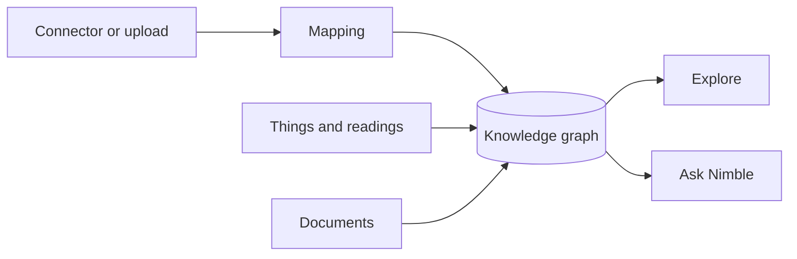

Dieser Bereich beantwortet zwei Fragen: Wie hängen meine Things, Orte und Dokumente zusammen, und was kann ich dazu fragen? Der Knowledge Graph enthält die Datensätze und ihre Verknüpfungen. Ask Nimble beantwortet Fragen aus diesem Graphen, Ihren Live-Messwerten und Ihren Dokumenten und zeigt seine Quellen.

:::info Dieser Bereich braucht „Nimble fragen und Knowledge“
Zwei Schalter müssen beide aktiv sein, sonst erscheint **Knowledge** nicht im Menü und jede `/knowledge`-Seite führt Sie zurück zur Startseite:

1. **Die Installation.** Ihre Plattform-Administration aktiviert sie. Ist sie aus, zeigt **Administration › Mandanteneinstellungen › Funktionen** „Auf dieser Installation nicht verfügbar“.
2. **Ihr Tenant.** Ein Tenant-Admin öffnet **Administration › Mandanteneinstellungen › Funktionen** und schaltet **Nimble fragen und Knowledge** ein.
:::

Knowledge hat eine eigene Berechtigung, getrennt von Things und Dashboards. Jeder sieht nur die Datensätze, die er öffnen darf. Zum Durchsuchen und Fragen genügen Lese- und Ausführungsrechte, die jede eingebaute Rolle hat. Den Graphen, das Datenmodell, die Quellen und den Zeitplan ändern darf, wer Bearbeitungsrechte hat (Modeler, Manager, Admin). Zugangsdaten braucht Admin. Siehe [Rollen und Berechtigungen](../administer/roles.mdx).

## Verstehen {#understand}

- [Der Knowledge Graph](./knowledge-graph.mdx): was der Graph enthält und wie Datensätze zusammenhängen.
- [Wie Ask Nimble antwortet](./ask-nimble-answers.mdx): was es liest, wie es Quellen angibt, welches Modell antwortet und wo es aufhört.

## Umsetzen {#do}

- [Standorte und Gebäude abbilden](./map-sites.mdx): die Ortshierarchie aufbauen und Things darin platzieren.
- [Eine Frage zu Ihren Daten stellen](./ask.mdx): fragen, die Quellen lesen, Feedback geben.
- [Eine externe Datenquelle anbinden](./outside-source.mdx): Datensätze aus SAP, einer Datenbank oder einer Datei laden.
- [Befunde zur Datenqualität beheben](./data-health.mdx): Verknüpfungen prüfen und den Abgleich planen.
- [Das KI-Modell wählen](./ai-model.mdx): ein Modell registrieren und die Ausweichreihenfolge festlegen.

## Nachschlagen {#look-up}

- [Typen und Traits](./types-and-traits.mdx): die Bausteine eines Datensatztyps.
- [Konnektor-Typen](./connector-types.mdx): die Felder jedes Konnektors.
