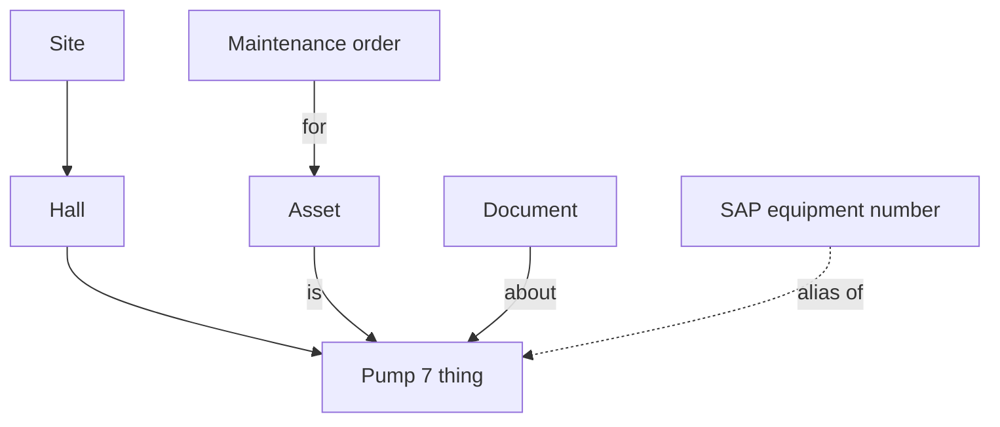

The knowledge graph is a set of records and the links between them. A record can be a thing (a device), a place (site, plant, hall, line), an asset, a maintenance order or a document. A link says how two records relate: this machine is in that hall, this order is for that asset, this manual covers that device. Explore draws the graph, and Ask Nimble follows its links to answer questions.

## The parts

| Part | What it is |
| --- | --- |
| **Record** | One item in the graph, such as a hall or an order. Every record has a **type**. |
| **Type** | A kind of record: its fields and the relations it may have. System types ship with the platform; you add your own. |
| **Trait** | A bundle of fields that types share, such as a position in the hierarchy or an access list. See [Types and traits](./types-and-traits.mdx). |
| **Level** | A place in the containment tree. Sites contain halls, halls contain lines. Things are placed at a level. |
| **Relation** | A named link from one record to another, such as `feedsInto`. |
| **Alias** | An identifier a record has in another system. Incoming data uses it to find the record. |

Things come from your devices and are kept in sync. Everything else you bring in: build levels by hand in Explore, load records from other systems through [connectors](./outside-source.mdx), or add documents to a level.

:::info A Knowledge type is not a thing type
A **thing type** under **Settings › Onboarding** describes a device's interface. A Knowledge **type** describes any record in the graph, including a device as the graph sees it.
:::

## How they work together

Records enter the graph in three ways. Devices appear as things, and their live readings stay in your time-series data. Outside systems arrive through a connector or upload into a staging source, and a **mapping** turns each row into a record of one of your types. People add levels, relations and documents in Explore.

A record that matches an existing one by alias updates it instead of duplicating it. A row that matches nothing waits in **Link review** until someone confirms the device it describes.

Access follows the record. Records with the **Governed** trait list the groups and users who may read them, and Explore and Ask Nimble show only what the signed-in person may open.

## Choosing between them

| You want to… | Use |
| --- | --- |
| See where things are and what is wrong in a hall | **Explore** on the **Hierarchy** view |
| List every record of one type | **Explore** on the **Table** view |
| See what a record is connected to | **Explore** on the **Graph** view |
| Ask in words, including about documents and trends | [Ask Nimble](./ask.mdx) |
| Chart one measurement over time | A [dashboard](../visualize/dashboards.mdx) |

## Limits

- Answers are only as good as the links. A record with no location or no relations is hard to find by a question about its place. [Data health](./data-health.mdx) lists these gaps.
- A record is placed at one level. Placing a thing elsewhere moves it.
- Narrowing a type does not delete data: values stay on existing records and are only dropped from the type.

## Related

- [Map your sites and buildings](./map-sites.mdx)
- [How Ask Nimble answers](./ask-nimble-answers.mdx)
- [Types and traits](./types-and-traits.mdx)
